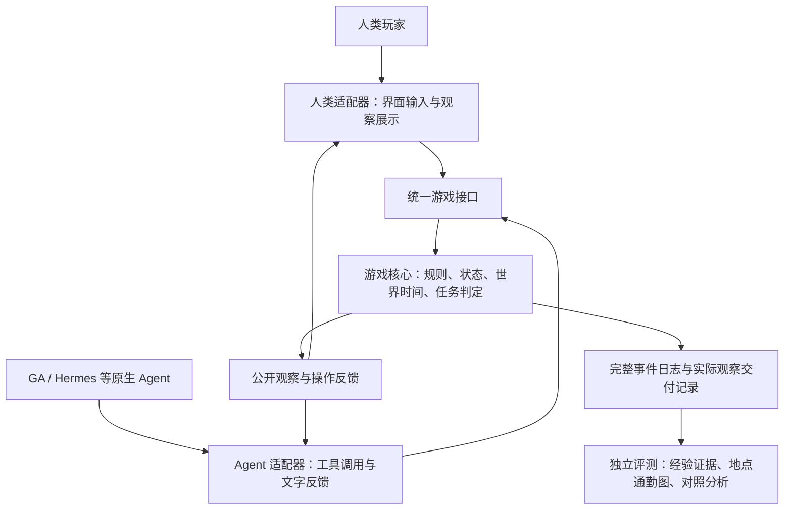

**制图探险游戏：软件架构**

**2026-10-15 已确定：同一个游戏核心，同时供人类和 agent 游玩。** 人类通过人类适配器操作，agent 通过 agent 适配器操作。世界规则、状态转移、观察范围、任务完成判定和轨迹记录由共同核心负责。下面记录架构方向和接口草案；具体技术栈与界面布局尚未确定。

研究与评测的整体技术路线见 [TECHNICAL_ROADMAP.md](TECHNICAL_ROADMAP.md)，经验驱动的任务与实验设计见 [EXPERIMENT_DESIGN.md](EXPERIMENT_DESIGN.md)。

**2026-10-16 当前实现。** 测绘已改为到达自动完成，主决策为道路选择和工具取用。无对应工具进入山谷或森林会产生额外体力消耗。规则核心统一结算，两个适配器收到相同公开后果；地图只包含地理信息。配置见 [经验目录](EXPERIENCE_CATALOG.md)。后文关于显式测量动作的描述属于上一版草案，当前以 `Game.ACTIONS` 为准。

**原型与 GA 跨 session 流程已实现。** `memorybenchmark/` 提供共享核心、人类界面、HTTP／JSON Lines 接口、完整事件日志和有序通勤图。GA 已接入独立会话、文件／网络隔离、记忆快照、逐任务配对干预与检查点恢复，见 [GA 流程](docs/GA_CROSS_SESSION.md)。Hermes 薄工具桥通过原生注册检查，完整执行接入随后进行。开发试跑与人工校准分别标记，不作为正式记忆效果实验。

**交互链路如下。**

图中的两类玩家通常在独立游戏实例中执行同一配置的任务，并非默认共同控制同一个角色或共享历史。接口允许以后实现其他玩法，首版不增加联机要求。

**游戏核心是世界状态的唯一写入方。** 核心加载地图、通路、条件规则、初始状态、任务和外部事件时间表；校验动作，计算后果，推进游戏时间，生成观察和事件。文字叙述和界面动画都由已发生的事件呈现，不能自行决定位置或通行结果。

地理图节点使用稳定地点标识。真实移动产生一次独立通勤事件；失败移动、原地调查、测量和等待产生对应操作事件。时间按游戏动作规定的时长推进；人类思考时间、界面渲染时间和模型调用延迟不推进世界时间。

**人类适配器负责可玩的界面。** 玩家通过按钮、地点选择和工具菜单提交统一动作；界面展示当前局部地理信息、天气、时间、任务和反馈。可以提供可视化表现，但不能从完整地图或隐藏规则推导出额外提示。初次获得的信息在游戏核心产生，不在界面中另写一套探索或通行规则。

**Agent 适配器提供文字交互。** 将公开观察转成文字，将统一动作注册为 agent 能调用的工具，再把操作反馈送回其原生执行循环。GA、Hermes 等各自使用薄适配层连接共同协议，其自主规划、记忆整理与检索保持原生实现。

文字交互采用明确的动作和参数，例如候选工具 `game_action(action="move", target="F")`；观察结果仍可用自然语言表达。需要花费游戏时间的观察和测量也是显式动作。读取已经交付的当前观察与重新执行调查分别处理。具体工具拆分方式待原型确定，动作不能靠对自由文本作模糊猜测而自动替换。

原生 agent 的文件和计算工具可服务其推理与记忆；游戏进程、完整地图、隐藏规则、GT 资料库和评分代码位于其不可访问的评测环境中。游戏状态只通过游戏接口改变。

**两套适配器共享动作语义和公开信息边界。** 同一状态下执行同一动作，应得到相同的游戏后果；观察可有文字和视觉两种呈现，但表示的信息来源一致。可选动作只表示当前可尝试的操作及已知对象，不根据未公开的成功条件提前删除危险选项。

地图成果只表达地理信息。界面不自动维护危险经验或通行规律图层；agent 跨任务可读取的经验由自己的记忆机制产生。benchmark 模式在每个任务边界重置界面缓存、临时地图和历史反馈，评测归档不提供给下一 session。人类玩家的自身记忆无法按程序清除，因此人类游玩首先服务体验检查、任务验证和行为案例，不能未经额外设计直接当作相同的 MEM/NOMEM 对照。

**接口草案围绕任务、动作和观察组织。**

| 接口职责 | 输入／输出 | 归属 |
| --- | --- | --- |
| 开始任务 | 任务配置 → 公开目标、初始观察、实例标识 | 运行器创建；适配器接收公开部分 |
| 执行动作 | 实例、请求标识、动作、参数 → 反馈、公开观察、终止状态 | 人类和 agent 共用 |
| 读取当前观察 | 已公开的当前观察与状态版本 | 人类和 agent 共用；不代替收费的调查动作 |
| 提交地图／结束 | 按目标检查成果及完成条件 | 核心判定，适配器只提交 |
| 快照与恢复 | 世界状态、时间、随机状态、事件位置 | 评测控制接口，不向玩家开放 |
| 获取评测记录 | 全状态日志、证据、图与分数 | 独立评测侧 |

动作请求需要关联唯一标识及状态版本，避免网络重发导致同一个移动被执行两次。受阻、工具条件不满足、超时或任务失败是正常游戏反馈；通信失败和服务崩溃采用单独的基础设施错误类型。只有后者触发恢复与重试，不能重跑真实失败来获得更好成绩。

**旧 AAAI 适配可作为迁移基础。** 已核对本地复现包：`backend/src/agent/ga_wrapper.py` 中的 GA 指 GenericAgent，并非 Google Antigravity。先前对该缩写的解释有误；后续选型和实现以实际代码为准。

| 旧对象 | 已有能力 | 新环境需要调整 |
| --- | --- | --- |
| `AgentInterface` | `reset`、`act(observation)`、记忆清除／备份／恢复 | 审核持久状态覆盖范围，加入游戏说明与结构化动作事件 |
| GA、Hermes wrapper 与 daemon | 原生执行、工具事件请求、环境反馈回传 | 把主要用于 `submit`、`run_test` 的桥接扩成通用游戏动作；任务内保持同一个 session |
| `BaseServer` / `EnvProxy` | `reset` / `step` 与文字观察返回 | 新增游戏服务与统一公开响应；隐藏评测字段不回传给 agent |
| `runner.py` | 任务流、配对、重试、任务内动作循环 | 移除新环境对“步数等于提交次数”的依赖；匹配两组提示及任务结束反思机会 |
| 旧 trajectory 存档 | 保存步骤观察和动作摘要 | 旧循环将观察和动作各截到 500 字符；新环境另存无截断的权威事件、实际交付内容与通勤顺序 |

文字交互本身已有接口基础。迁移的实质是让每个游戏操作都通过环境校验、执行和记录，同时保持 agent 的自主记忆机制。任务内多次操作不新建 session，任务之间按实验协议新建 session，记忆按处理条件保留或清除。

**首个实现范围。** 先实现最小地图的核心规则与事件记录，再接一个简易人类界面和 Hermes 文字工具适配，最后接 GenericAgent。两套客户端用相同动作脚本验证状态、反馈语义和日志一致性，再开展真实 agent 的记忆对照。地图和校准轨迹以实验设计文档中的最小验证草案为起点；完整游戏界面和四档难度后续展开。
