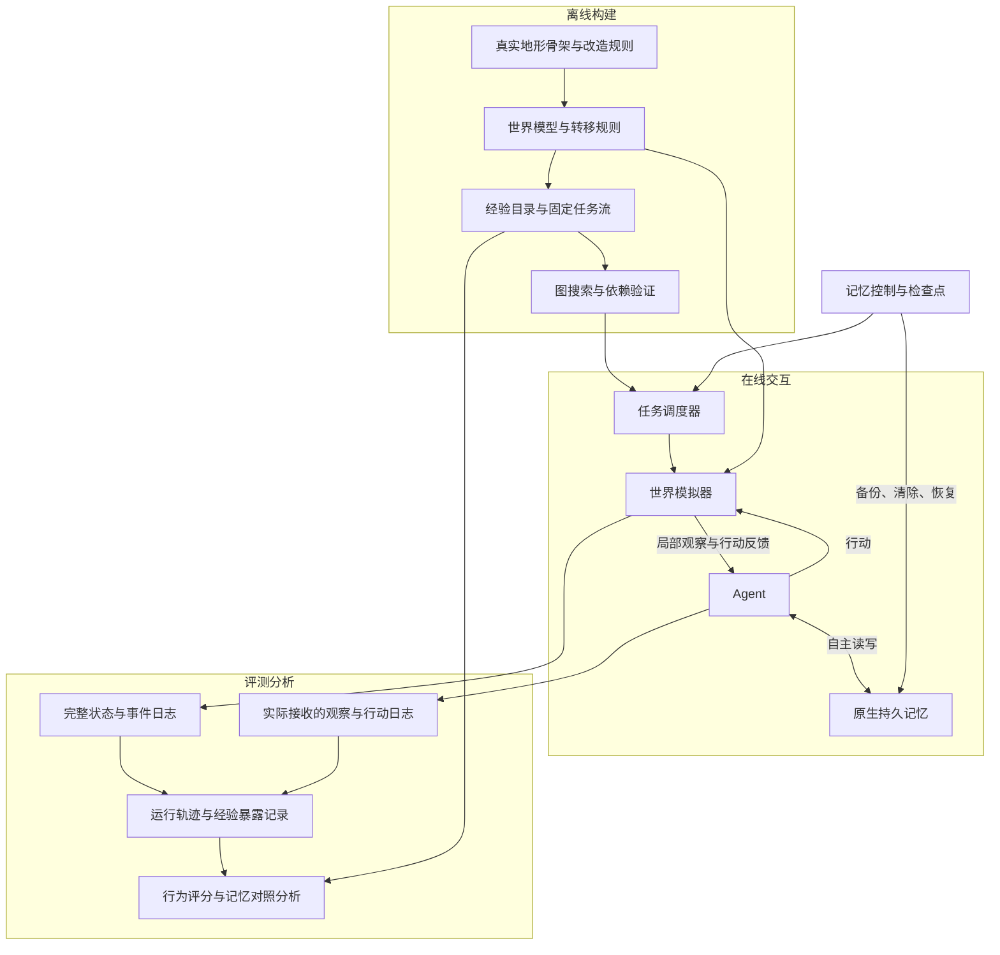

**跨任务 Agent 记忆评测：整体技术路线**

本文定义新版 benchmark 的研究目标、环境建模、任务构造、记忆协议、评测方法和工程接口。内容是拟实现的技术设计；具体地图、参数规模与实验配置在原型验证后冻结。本文不安排时间计划。

**研究目标是评估完整 agent 如何把过去经历转化为对未来任务有用的记忆。** 被测对象包括 agent 的规划、经验整理、原生持久记忆、检索及其在行动中的使用。关注的结果是历史经验是否改善了后续决策，以及这种作用如何受到间隔、任务变化和世界变化的影响。

任务场景采用连续探险：agent 在局部可观察的世界中探索、补给、应对危险和完成委托，逐步形成能够支持行动的地图。制图是任务层面的长期目标；记忆对未来行为的作用是研究层面的评测目标。

世界使用真实地形骨架改造而成，包含 Easy、Normal、Hard、Lunatic 四档，空间尺度依次增大，每档包含多个世界。每个世界采用预先验证并冻结的任务流。每个任务开启独立 session，跨 session 没有历史对话或临时上下文，历史信息只能来自 agent 的记忆库。

地图成果只表达地理内容，包括地形、地标位置、方向、连接和任务要求的测绘信息。水源、休息条件、地理工具使用方法及条件危险由 agent 作为经验自行保存到记忆库，系统不把这些内容写成地图经验图层，也不将历史地图成果直接提供给下一 session。

评分分为两条路径：当前任务按完成质量评价，经验的未来价值以后续任务的 GT 图与实际 trace 图的数学关系评价。当前选定的 trace 表示是地点通勤有向多重图：到达地点作节点，每次地点间通勤作边，重复通勤独立保留。GT 来自正确整合此前经验后完成当前任务的参考 trace。当前优先设计经验、任务与 GT 的递推构造，指标公式后续讨论。

整体研究链条为：

> 经历提供证据 → agent 自主形成并保存记忆 → 后续任务出现使用机会 → 行为体现经验作用 → 对照实验检验记忆贡献。

| 研究问题 | 任务之间的关系 | 需要观察的现象 |
| --- | --- | --- |
| 获取与复用 | 首次探索后出现相关的新任务 | 已接触的信息能否支持后续行动 |
| 组合与迁移 | 多次经历提供不同知识，后续目标或约束改变 | 能否组合经验，并在新条件下正确应用 |
| 失败经验利用 | 一次经历受阻、受损或失败，后续再次面临相关选择 | 失败产生的信息是否帮助未来任务 |
| 长期保持 | 经验与使用机会之间存在间隔任务 | 经验作用如何随间隔变化 |
| 修正与更新 | 获得更正证据，或观察到世界变化 | 能否修正认识、更新知识有效范围 |
| 干扰与适用性 | 插入无关或相似经历，后续需要特定经验 | 能否选择相关经验、避免错误套用 |

失败经历具有未来价值是需要检验的现象。一次失败是否有用，取决于它实际提供了什么证据，以及后续任务是否存在相应使用机会。轨迹相似度可以作为描述性信息，但不能直接等同于记忆复用程度。

**总体架构分为离线构建、在线交互、记忆控制和评测分析四部分。** 世界模拟器掌握完整状态，agent 接收局部观察，评测器独立记录真实状态和实际暴露的证据。



**世界构建模块把地理骨架转为带规则的可执行环境。** 输入可以是山谷、海岸、岛屿、河网或山脉的地理资料。构建流程依次完成区域抽象、地点与通路提取、结构改造、属性配置和观察配置，输出版本化的 `WorldSpec`。

| 世界对象 | 核心字段 | 用途 |
| --- | --- | --- |
| 地理地点 | 标识、地形、地标、相对位置 | 定位、探索与地理制图 |
| 地理连接 | 起终点、方向和地理测量 | 描述空间关系与地理结构 |
| 交互对象与规则 | 水源、休息条件、行动反馈、通行条件 | 在当前 session 中提供可探索的经验，保留在模拟器规则层 |
| 探险与工具规则 | 补给消耗、疲劳、定位与测量工具作用 | 让历史知识影响行动可行性和测量质量 |
| 动态事件 | 触发条件、状态变化、可见反馈 | 构造环境变化与知识更新 |
| 观察规则 | 可见范围、调查结果、反馈内容 | 控制 agent 在何时获得哪些证据 |

地理图允许方向性和同一对地点之间的多条通路。真实地理用于提供空间结构；资源、条件路线和变化事件由 benchmark 的交互规则定义。地图的地理结构、规则层的经验来源和评测侧的真值分别管理。名称替换、结构修改与规则修改分别记录，便于检查地理先验和表面提示的影响。

生存机制应当产生可复用经验。例如，水源位置影响长途补给，天气影响路线选择，休息条件影响行动安排。地理工具服务定位、观察和测量，例如罗盘、望远镜或测量工具；具体种类和操作规则待定。第一版采用有限的状态变量和离散规则，使任务能够求解、验证和重放。

**图论建模以完整环境状态为基础，并保留不同层次的图。** 地理位置是状态的一个组成部分。完整状态可表示为：

\[
s_t=(v_t,r_t,t_t,w_t,z_t,q_t).
\]

其中，\(v_t\) 是位置，\(r_t\) 是探险资源与地理工具状态，\(t_t\) 是世界时间，\(w_t\) 是天气等动态条件，\(z_t\) 是道路、资源点和对象状态，\(q_t\) 是当前任务进度。状态中应包含决定后续环境转移所需的信息。这是评测侧的完整环境状态，不是 agent 地图成果的字段集合。

模拟器执行：

\[
s_{t+1}=T_\theta(s_t,a_t,\xi_t),
\qquad
o_{t+1}=O_\theta(s_{t+1},a_t,\text{event}_t).
\]

\(\theta\) 表示世界配置；\(\xi_t\) 表示可选的随机输入。确定性版本可以省略随机输入。观察函数只输出当前允许 agent 获得的信息。

| 图结构 | 节点和边 | 技术作用 |
| --- | --- | --- |
| 地理图 | 地点、通路 | 连通性、区域、瓶颈、替代路线 |
| 状态转移图 | 完整状态、动作转移 | 资源约束、行动后果、可行方案与代价 |
| 任务—经验依赖图 | 任务、经验、产生与使用关系 | 固定任务流构建与依赖检查 |
| 地点通勤图 | 到达的地点、每次地点间通勤的有向多重边 | 统一记录探索、取物、补给、折返等移动过程，与任务 GT 比较 |
| 显式制图结果 | agent 报告的地形、位置、方向、连接和地理测量 | 按任务要求评价地理制图质量 |

状态转移图通过模拟器按需展开。图搜索查询一个状态的合法后继，无须预先枚举所有状态组合。资源、天气和任务进度不同，即使地理位置相同，也可能是不同状态。

运行日志保留完整状态、动作、观察与通勤顺序，供参考规划、任务检查和证据提取使用。评测主图按地理地点标识投影，每次通勤生成独立边，避免简单图合并重复通勤。原地观测和测量保留在完整 trace 中，不要求把工具、资源或任务进度展开为通勤图节点。

agent 的内部记忆保持实现自由。评测要求环境、任务和行为具有可分析的图结构，不要求 agent 采用图数据库或显式世界模型。

**任务构造围绕可验证的经验依赖展开。** 每个任务使用 `TaskSpec` 描述目标、起始状态、硬约束、预算、成功与失败条件、世界版本及经验关联。任务目标采用可计算的条件，例如抵达指定地点、完成指定测量、运送对象、保证健康阈值或提交地图。

经验使用独立的 `ExperienceSpec` 描述：

```text
experience_id
claim                    事实或规律
scope                    适用地点、天气、工具和任务条件
validity                 有效版本或时间范围
evidence_matchers        哪些可见事件能提供相应证据
potential_sources        哪些任务可能产生这些证据
potential_consumers      哪些任务存在使用机会
```

经验目录是评测侧的语义标注。运行时只有实际暴露的反馈符合证据规则，才登记对应证据。单次事件的证据范围应与反馈内容一致，不能由一次失败自动推导出未被告知的普遍规律。

任务—经验关系采用有向二部图：`任务 → 经验证据 → 后续任务`。对于组合任务，进一步使用依赖组表达 `ALL` 和 `ANY`：前者表示需要联合信息，后者表示存在多套可行知识组合。

任务流通过以下关系组织：探索产生信息、改变目标后的复用、跨区域组合、间隔后的再利用、失败经验的后续使用，以及纠错或变化后的更新。空间区域可以重叠，任务可以穿越多个区域。固定任务顺序和世界事件安排序列化为 `StreamManifest`。

构建统计包括经验的后续使用机会数、任务的历史依赖数量、组合深度和复用间隔。这些量描述任务设计，不直接当作 agent 的记忆分数。保持实验还要记录中间是否再次接触相同证据，以区分长期保持与反复刷新。

每个任务的构建还要产生 GT。构建器维护评测侧参考经验集合，按“累计经验与当前目标 → 构造任务 → 参考规划与执行 → 生成地点通勤 GT 图 → 提取可见证据并更新经验”的顺序递推。GT 规划必须满足当前任务的工具取用、测量、资源和返回等约束，只使用此前获得及当前执行中按规则揭示的信息。必要访问和合理调查均可以出现在 GT 中。

每条经验要标明其规划作用，例如要求先访问工具点、支持新的区域连接、修正条件下的通行判断或满足补给要求。参考经验不直接输入实际 agent。任务流和 GT 在运行前冻结，实际证据暴露另行记录。多个同等合理的参考过程可以保存为一组 GT 或生成约束。具体递推定义与三任务示例见 [实验设计](EXPERIMENT_DESIGN.md)。

**验证器检查任务是否可解，以及指定经验是否具有决策价值。** 两类验证分别产生任务可行性报告和经验依赖报告。

| 验证内容 | 计算方式 | 应输出的信息 |
| --- | --- | --- |
| 地点与目标可达 | 图遍历、可达性分析 | 是否可达、阻断条件 |
| 已知世界下的完成代价 | 加权图搜索 | 参考路径、代价、求解状态 |
| 补给、时间与工具约束 | 扩展状态图搜索 | 满足约束的行动序列 |
| 多地点勘测要求 | 带访问要求的路径规划 | 访问与测量是否完成 |
| 条件路线与更新 | 条件检查、版本检查 | 哪些状态下经验有效 |
| 经验组合与替代解 | 依赖组检查、替代方案搜索 | 哪些经验组足够，是否存在绕开依赖的方案 |

经验验证还要检查当前观察与历史信息之间的差异：当前任务若已直接告知某条路线，使用该路线不能单凭行为被解释为历史记忆的作用。

对能够精确求解的实例，保存最优值和验证路径。对较大实例，保存可行解、上下界或未完成求解状态，并明确其含义。全知状态图的最优值是特定信息条件下的参照；未知世界中的合理信息获取需要单独考虑。

**Agent 适配层提供统一交互接口，保留原生记忆实现。** 建议交互契约为：

```text
reset_task(instruction, initial_observation)
act(observation) -> action
finish_task(result)

snapshot_memory() -> snapshot_ref
restore_memory(snapshot_ref)
clear_memory()
reset_session()
```

环境动作包括移动、观察、勘测、采集、休息、地理工具使用和撤退。参数使用当前可识别的对象或通路标识。规则引擎检查动作的条件并计算后果。动作可以通过结构化调用传输；世界状态和评分由程序规则决定。

当前可尝试动作与隐藏的成功条件分别处理。公开动作信息不能提前利用隐藏真值筛选出所有安全路线。反馈可以揭示行动结果及环境设定允许获知的原因。

任务边界需要明确定义状态归属：

| 状态 | 处理规则 |
| --- | --- |
| 当前任务会话与临时上下文 | 任务结束后清空，下一任务开启独立 session |
| 位置、补给、疲劳与地理工具等探险状态 | 按下一任务的起始配置初始化 |
| 世界结构和动态版本 | 按固定任务流规定加载 |
| agent 自主保存的长期笔记、地理知识、数据库与可检索历史 | 统一纳入声明的记忆库，作为唯一跨 session 历史信息渠道 |
| 提交的地图成果与历史 trace | 由评测侧存档，不自动提供给下一 session |
| 评测日志与完整世界真值 | 仅评测侧可访问 |
| agent 创建的路标、营地或其他环境标记 | 第一版在任务边界重置，不用于跨 session 传递历史信息 |

第一版采用任务指定的物理初始状态与外部事件安排。跨 session 不通过历史工作区、共享地图或 agent 留下的世界标记传递经验。该边界沿用 AAAI 版正文第 2 页的任务内上下文与持久记忆区分；旧论文未纳入本仓库。

MEM 与 NOMEM 在任务内保留正常上下文、具有相同任务提示和结束反思机会。NOMEM 在任务边界清除跨任务持久状态；两组的额外记忆操作开销分别记录。原生适配器若无法实现某项严格控制，需要在配置和结果中注明实际处理差异。

**运行记录建立事实、证据和行为之间的对应关系。** 世界模拟器保存完整状态日志，交互层保存 agent 实际收到的观察。两类日志通过运行、任务、步骤和事件标识关联。

```text
TransitionEvent
  run_id / task_id / step_id / event_id
  world_version
  state_before / state_after       # 评测侧
  action
  observation_delivered           # 实际发送给 agent 的内容
  emitted_events
  simulated_time / resource_cost
  terminal_status
```

由可见事件生成每次运行独立的 `EvidenceLedger`，记录经验对应的证据、暴露位置、条件、版本和时间。它只证明证据被提供过。记忆写入、检索与实际应用需要另行分析；原生系统能够提供相应操作日志时，可作为辅助证据。

架构因此保留三个独立字段：

> `potential_exposure`：任务设计提供机会；`observed_evidence`：运行实际暴露证据；`behavioral_effect`：后续对照中观察到的行为作用。

评分使用明确的任务结果和可见证据。不能因为评测器知道某条路有危险，就把 agent 首次尝试该路线计为重复犯错。

**记忆效应通过完整任务流比较与检查点干预共同分析。** 两种协议分别服务于累计系统效果和相同历史下的局部诊断。

| 协议 | 控制方式 | 可以支持的解释 |
| --- | --- | --- |
| 完整任务流配对 | 相同配置、任务顺序与外部事件规则，分别运行 MEM / NOMEM | 整套跨任务记忆处理的累计效果 |
| 检查点分支 | 从共同历史出发，固定后续任务和环境状态，改变记忆可访问性 | 在该历史与任务条件下，记忆可用性对行为的影响 |
| 历史证据辅助条件 | 提供共同历史中实际暴露的、经过整理的相关证据 | 判断已有证据能否帮助任务，辅助定位保存、检索或使用问题 |

完整任务流中的两组可能接触不同证据，这属于累计效果的一部分，不能直接把全部差异归因于某一条经验。检查点协议在预先规定的位置分支，避免只挑选双方都到达某个状态的轨迹。

检查点应包含世界版本、完整环境状态、任务进度、随机状态和 agent 持久状态，并在历史记忆读入新任务上下文之前建立。辅助分支不得影响主任务流后续的环境或记忆。

历史证据辅助条件只整理此前实际获得的内容，不补充未观察到的地图或隐藏规则，也不自动构成性能上界。需要研究单条经验作用时，可在支持内容级干预的适配器上扩展删除、替换与无关内容对照。

若引入随机性，需要明确外部事件如何与世界时间或事件标识绑定。仅设置相同随机种子，并不保证不同动作序列经历相同外部条件。

**当前任务结果与经验未来价值分别评价。** 当前任务的完成质量由目标完成情况、地理成果和规定约束决定。历史经验的未来价值通过后续任务的地点通勤图分析：比较正确使用历史经验得到的 GT 图与实际 agent 的图。两者采用一致的地点标识与多重边表示。当前先完成任务和 GT 的生成规则，下表保留候选分析方向，具体指标公式后续定义。

经验目录与证据记录支持任务依赖设计和指标解释，不要求 agent 把经验写入地图，也不作为替代 trace 图指标的经验评分清单。配对运行与检查点干预用于分析图指标的变化与记忆条件之间的关系。

| 指标类别 | 主要内容 | 解释边界 |
| --- | --- | --- |
| 任务结果 | 完成度、生存、约束满足 | 失败和预算耗尽均计入结果 |
| 行动成本 | 时间、资源、受损与恢复代价 | 必要勘测和补给不自动视为浪费 |
| 关键选择 | 条件路线选择、补给准备、恢复行为 | 接受所有满足当前任务要求的合理方案 |
| 失败经验利用 | 后续 trace 图中的失败转移误用、恢复或替代路径等候选指标 | 具体公式待定；检查证据、条件与使用机会 |
| 保持与组合 | 不同间隔下的图指标、跨历史区域的路径组合等候选指标 | 具体公式待定；记录中间刷新与替代信息来源 |
| 修正与更新 | 更新证据后的 trace 图变化、旧转移重复尝试等候选指标 | 具体公式待定；首次发现未知变化单独记录 |
| 制图结果 | 地形、位置、方向、连接和测绘信息的正确性与完整性 | 属于当前任务的地理成果质量 |
| 系统成本 | token、调用、耗时、存储与记忆操作成本 | 区分游戏代价与计算开销 |

对于方向一致、数值越高越好的结果量 \(Y\)，配对差异可以写为：

\[
\Delta Y_i=Y_i^{\mathrm{MEM}}-Y_i^{\mathrm{NOMEM}}.
\]

成本量单独报告，并明确差值方向。检查点实验在共同历史条件下计算相应差异。各项指标保留单位与条件，避免过早压缩成含义不清的单一总分。

全知参考路径与实际轨迹的代价差可以描述相对参考解的表现，但不能直接解释为记忆错误。未知区域的调查、合理的安全冗余、必要返回和变化后的重新验证，都可能有任务价值。

使用机会的比例指标同时报告分母、证据覆盖与未到达情况。完整任务流结果不因缺少特定机会而被删去。统计保留世界、地形家族、完整任务流和重复运行之间的层级关系。

**数据构建和评测校准使用同一套可检查的对象。** 四档难度按空间尺度递增，另行记录节点与边规模、条件数量、任务长度、经验组合深度和复用间隔，使难度变化具有可解释性。

每张地图的任务顺序固定；多张独立地图提供不同的空间结构和经验关系。开发与测试按地图或地形家族分组，同一地形的改名或近似变体保留共同来源标识。

验证器和评分器先用行为可控的参照策略校准：重新探索、保存已观察事实、遗忘早期事实、忽略失败证据、继续使用旧知识。检查各项诊断是否能反映其已知行为，并设置缺少相关历史的对照任务。实际 LLM agent 能否受益属于实验结果，不作为数据筛选条件。

最终地图由 agent 在规定任务中提交，仅记录地理内容。评测器保存所有提交用于评价任务质量，不把历史地图或经验注释提供给后续 session。agent 自己保存并检索的地理知识或经验必须通过声明的记忆库传递。

**工程实现沿用现有运行骨架，新增环境、经验和评测能力。** 既有项目代码已经提供环境交互、原生 agent 适配、任务序列化与运行管理接口，可以作为迁移基础。下表路径相对于旧项目的复现包；旧代码未纳入本仓库。

| 现有文件 | 建议调整 |
| --- | --- |
| 环境基类 `backend/src/env/base_server.py` | 接入探险模拟器，扩展完整环境快照与恢复协议 |
| 环境代理 `backend/src/env/proxy.py` | 注册新环境，传输动作与公开观察，支持检查点命令 |
| Agent 接口 `backend/src/agent/base_wrapper.py` | 沿用会话和记忆接口，检查原生持久状态覆盖范围 |
| 任务结构 `backend/src/task/task.py` | 增加世界版本、约束、经验引用及多任务依赖 |
| 任务流框架 `backend/src/stream/base_stream.py` | 增加固定清单加载和验证，支持经验依赖结构 |
| 运行控制器 `backend/src/runner.py` | 管理配对实验、完整检查点、逐动作日志和正常任务失败 |
| 代码与状态说明 `docs/CODE_GUIDE.md` | 更新任务边界、处理差异和重试语义的契约 |

现有 `related_to` 单一引用不足以表达多经验组合。新的依赖结构应以独立的经验标识和依赖组保存，再按需要生成任务之间的关系视图。

模拟器的逐动作计数需要与旧环境的提交次数语义分开。受伤、死亡、任务超时和预算耗尽是正常游戏结果；接口故障、通信失败等基础设施问题才执行重试。重试必须恢复对应的环境与 agent 状态。

接口响应中的公开观察与评测元数据需要显式分离。完整状态、隐藏属性、经验标签、参考路径和求解器结果不得经由 `info` 或日志目录进入 agent 的可访问范围。

建议新增以下职责模块，具体目录可以在实现时与现有结构对齐：

```text
world/          世界配置、规则引擎、观察函数、事件处理
tasks/          任务定义、固定任务流与经验依赖
validation/     图搜索、可行性检查、经验依赖验证
protocol/       任务边界、记忆处理、检查点与分支控制
trace/          状态事件、可见观察、证据记录与重放
evaluation/     任务评分、图分析、记忆对照与统计汇总
```

**可复现产物由配置、运行证据和评测结果组成。** 核心对象及其归属如下：

| 产物 | 内容 | 使用方 |
| --- | --- | --- |
| `WorldSpec` | 完整世界、转移与观察规则 | 构建器、模拟器、评测器 |
| `TaskSpec` | 目标、约束、初始状态及关联元数据 | 调度器；agent 接收其中的公开任务说明 |
| `TaskGroundTruth` | 参考经验、合法参考 trace、地点通勤 GT 图及生成条件 | 构建器、验证器、评测器；实际 agent 不可访问 |
| `ExperienceSpec` | 经验语义、证据规则、条件与版本 | 构建器、验证器、评测器 |
| `StreamManifest` | 固定任务顺序和世界变化安排 | 调度器、复现程序 |
| `RunManifest` | 模型、agent、处理条件、配置版本与预算 | 运行器、分析程序 |
| `TransitionLog` | 完整状态、动作、观察和事件 | 重放、轨迹分析与评分 |
| `EvidenceLedger` | 本次运行实际暴露的经验证据 | 经验作用分析 |
| `Checkpoints` | 环境和 agent 持久状态快照 | 重试、干预与复现 |
| `EvaluationReport` | 任务表现、图分析、对照结果和成本 | 研究分析与论文 |

各产物记录版本与内容标识，保证结果能够追溯到同一套世界规则、任务定义和评分规则。核心技术链条的每一段都应有对应记录：一项经验在哪里出现了证据、是否实际暴露、适用于哪些后续情境，以及在匹配的对照条件下是否改变了行为。
