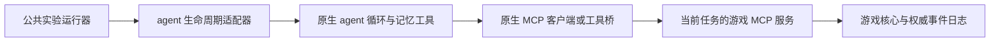

# 统一游戏 MCP 与原生 agent 适配

游戏接口只实现一套。`mcp_game.py` 使用官方 MCP Python SDK，固定 `mcp==1.30.0`，协商协议为 `2025-11-25`。标准 stdio 服务与正式运行器的内存传输使用同一个 `create_server()`，唯一工具为 `game_action`。动作、公开观察和 trace 均由原有游戏核心产生。



公共运行器负责每任务新进程、隔离、两阶段预算、记忆基线和快照、相同历史检查点的保留／清除对照、中断恢复和观测台。适配器负责准备原生代码、选择 worker，并让工具调用和结算反馈回到原生循环。经验的提炼、组织、检索和保存由 agent 自己完成。

## 安装与正式运行

游戏本身仍只依赖标准库；MCP 与正式 agent 运行需要可选依赖：

```powershell
python -m venv .venv
.venv/Scripts/python -m pip install -e ".[mcp]"
.venv/Scripts/python -m memorybenchmark.experiment --list-agents
```

Linux 的独立 MCP 试玩使用 `.venv/bin/python`。正式 GA 适配当前使用 Windows 主机上的 WSL2／bubblewrap 隔离启动器，还需要原生归档，见 [GA 跨 session 协议](GA_CROSS_SESSION.md)。凭据只通过父进程的 `MEMORYBENCH_GATEWAY_KEY` 提供。

```powershell
.venv/Scripts/python -m memorybenchmark.experiment reproducibility_package_upload/agents/GenericAgent_src.tar.xz --agent ga --base-url https://your-model-gateway --tasks T1 T2 T3 T4 T5 T6 T7 T8 --max-turns 48 --final-turns 6
```

安装后也可使用 `memorybenchmark-run`。新入口默认写入 `.runs/agent-cross-session/<运行编号>/`；观测台同时读取此目录和旧的 `.runs/ga-cross-session/`。`python -m memorybenchmark.ga_experiment` 保留为 GA 兼容入口。恢复使用 `--resume <运行目录>`，不改变记录的 agent、提示、预算或游戏传输。

未知 agent、缺少插件、插件协议不匹配会在创建实验和调用模型之前以配置错误退出，不生成任务零分，也不退回裸模型。`hermes` 当前明确标记为 `tool_bridge_only`，没有将它作为已完成的全流程适配器发布。

## 原生 MCP 客户端如何试玩

任何兼容客户端都可连接以下 stdio 命令，先调用 `game_action(action="read")` 获得当前委托，再执行动作：

```powershell
python -m memorybenchmark.mcp_server --scenario lake-easy --task T1
```

安装后等价命令为 `memorybenchmark-mcp`。客户端按各自的 MCP 配置格式填写同一个 Python 可执行文件、`-m memorybenchmark.mcp_server --scenario lake-easy --task T1` 参数和项目工作目录。stdout 仅发送 MCP 消息；日志写入宿主 `.runs/mcp-play/` 或 `--output` 指定的新目录。

任务由宿主在启动时选定。工具不提供新建任务、选择其他实例、快照、完整地图、未来委托、评分资料或记忆管理。输入参数与现有 `GAME_TOOL` 一致：`action` 加可选的 `target`。返回 JSON 文本与同内容的 `structuredContent`，其中包含最新公开观察和文字反馈。写操作串行执行。原生桥可通过请求 `_meta["memorybenchmark/action"]` 携带 `request_id` 和 `expected_revision`，重发与过期版本沿用游戏核心的语义。

这是单任务试玩入口，不是完整记忆实验。试玩清单明确记录 `mcp_single_task_play_not_memory_evaluation`。正式评测必须由生命周期适配器落实隔离、会话清理和记忆干预；不能让 agent 的文件工具访问服务端游戏源码、地图或宿主日志。

## GA 如何复用服务

归档中的 GA 没有现成 MCP 客户端，因此保留其原生工具注册桥：

```text
GA 原生 game_action 工具
    → worker 的 JSON Lines 管道
    → 宿主的官方 MCP ClientSession
    → 同一个游戏 MCP Server（内存传输，无新增端口）
    → 当前任务的 GameAdapter 与游戏核心
```

正式运行实际完成 MCP 初始化、工具发现和 `tools/call`，没有把旧 RPC 路径仅改个名字。GA 的记忆、文件、整理工具和原生 `agent_runner_loop` 保留。主循环结束后，在同一个 agent、handler 和对话 backend 上提供统一的末尾整理机会；保留／清除组的提示和预算相同。短委托直接显示在反馈中，每次模型调用附带简短要求，不生成 `current_task.md`。

新运行记录 adapter 版本与源文件哈希、冻结的 worker／support 文件清单、MCP SDK／协议／工具 schema 与服务实现哈希。恢复前检查这些信息。旧运行没有新标签时继续使用冻结 worker 与旧的直接 RPC，不混入新条件。

## 用户增加一个 agent

论文包含的 agent 由维护者提供适配器。新增 agent 的用户提供一个可导入的工厂：

```powershell
python -m memorybenchmark.experiment path/to/native-worker-bundle --agent custom --adapter examples.custom_agent_adapter:create_adapter --base-url https://your-model-gateway
```

[示例插件](../examples/custom_agent_adapter.py) 是模板，不是另一个已评测的 agent。插件继承 `AgentAdapter`，声明 agent ID、版本、worker 和提示协议，实现 `prepare(archive, root)`，返回 `PreparedAgent(source, support, baseline)`。默认 `create_sessions()` 复用公共 `WorkerSessions`，无需重写配对、记忆清除、恢复、记录或评分。原生接口特殊时可覆盖会话后端，但必须遵守相同实验协议并提供对应验证。

模板 bundle 结构为：

```text
bundle/
  source/                  原生 agent 代码，运行时只读挂载到 /agent
  support/agent_worker.py   用户实现的原生调用与反馈绑定
  baseline/                原生持久经验存储的初始内容
```

三个目录分开准备。唯一跨任务持久可写目录是 `/agent/memory`；会话历史、临时状态和工作目录每个任务重建。原生记忆所依赖的规范与默认技能应完整保留，不能向 baseline 写入本游戏的人工经验。若原生 agent 使用数据库、技能文件或后台进程，应明确哪些属于经验、哪些属于会话历史，并验证清除与回滚完整覆盖；新建 session 本身不能证明不存在历史检索通道。

### Worker 契约 `agent-session-1`

worker 在与 GA 相同的隔离启动器中运行。源码和 support 只读，环境中没有真实模型凭据和宿主网络。启动时 stdin 收到一行配置，包含 `protocol`、`seed`、`model`、`initial_text`、`task_observation`、`max_turns`、`final_turns`；`probe_only=true` 时只做环境探测。

worker 与父进程使用 JSON Lines，请求结构为 `{"kind":"request","id":1,"method":"game","params":{...}}`，响应为 `{"id":1,"result":{...}}`。

| 消息 | 作用 |
| --- | --- |
| `request / game` | 仅 `read` 或当前任务的 `action`，由公共运行器接入 MCP |
| `request / model` | 原生模型请求转发；当前公共网关接受 Responses 输入、工具与 reasoning，返回 SSE 行 |
| `request / task_end` | 主循环结束后结算；返回当前实际结果，之后进入独立末尾预算 |
| `session` | 记录原生版本、工具和空 history／working 的初始证据 |
| `tool` / `log` | 原生工具事件与运行日志，不代替游戏权威事件 |
| `finished` | 主循环与整理完成，进程随后退出；退出后才生成记忆快照 |
| `worker_error` | 基础设施错误，不计为游戏失败，不推进公共历史 |

完整可运行参照是 `ga_worker.py`；GA 的兼容协议名保留为 `ga-session-1`，由其适配器声明。原生 agent 的调用、工具注册、模型 backend 对接仍需用户实现，模板不会自动替用户完成这些绑定。它们属于每种 agent 一次性的接入工作。

## 验证与当前支持范围

```powershell
.venv/Scripts/python -m unittest discover -s tests -v
.venv/Scripts/python scripts/check_ga_sessions.py reproducibility_package_upload/agents/GenericAgent_src.tar.xz
python scripts/check_native_contracts.py reproducibility_package_upload/agents
```

普通测试包含官方客户端的真实 stdio 初始化／工具发现／调用、公开信息边界、MCP 与直接执行结果一致、请求重放和关闭状态、缺失适配器提前退出、新旧观测目录兼容。没有安装可选依赖时，MCP 集成测试明确跳过；CI 安装该依赖后运行它们。

GA 离线契约检查使用真实原生 GA、WSL 隔离与新的 MCP 通路，模型响应为人工脚本。检查真实上下文裁剪、原生整理工具读取规范、新 session 的空上下文、记忆保留／清除与失败恢复。测试标记不是经验，结果不是模型记忆成绩，也不调用真实模型。

Hermes 的 `register_hermes()` 原生工具注册契约继续保留；完整 session 与持久化范围的适配尚未完成。旧开发脚本 `native_ga_smoke.py` 和 `HTTPGameClient` 仅用于开发，不作为正式隔离运行器。

官方协议与 SDK 依据：[MCP 工具](https://modelcontextprotocol.io/specification/2025-11-25/server/tools)、[Python SDK v1.30.0](https://github.com/modelcontextprotocol/python-sdk/tree/v1.30.0)。
