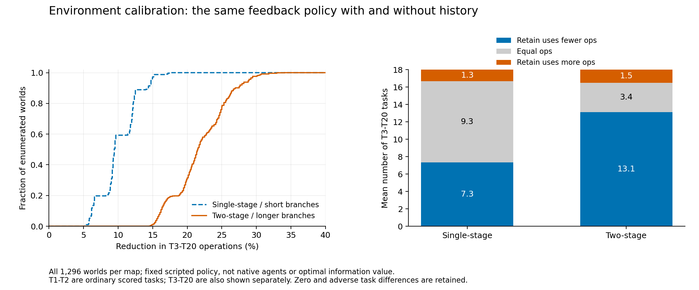
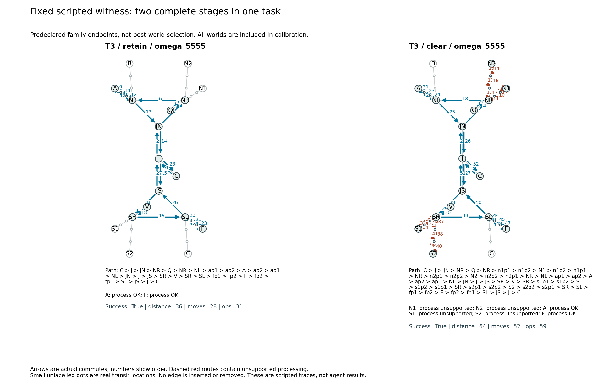

# 岚汀丘地：联程巡测与历史信息校验

版本 `lanting-easy20-linked-v3`，配置 [station_easy20_linked.json](../memorybenchmark/data/station_easy20_linked.json)。本版接替 `/easy20` 的四站巡测版；四站配置、原生 GA／Hermes 的旧成绩和完整证据保留。本版已完成机制校验，尚未取得新地图上的真实 Agent 成绩。

## 任务怎样改变

地图有 70 个地点、77 条道路、8 个独立环路。仍是四个独立站群，每组四站、两种资料各有两座匹配站，共 1,296 个均衡能力世界。每轮能力稳定，公开名称和地理不能确定能力。

每封委托现在包含两段来自不同站群的行程，共二十封、四十次站点决策机会。例如 T1：

1. 从 C 出发，到 P 自动采集剖面资料，在匹配站处理。
2. 继续前往 R，重新采集方位资料，在另一个站群的匹配站处理。
3. 回 C 提交整封委托。

两段属于同一个任务、同一个原生 Agent loop。第一段处理成功时 `done=false`，公开状态切换为第二段；只有两段完成并回营提交才成功。下一封才清空上下文、位置和当前资料，只保留 Agent 自己维护的原生记忆。提前经过第二段目标不能代替第二段的采集。

二十封按站群组合交错复用，两种资料和两个采集点都反复出现，既包含相同要求，也包含更换目标或类型的要求。第一封起都是正常任务，没有单独训练阶段或强制观察环节。Agent 可以自由改道、查询或试处理；任务失败时只计算实际收到的反馈，不假定必然学到整张地图。

每座站的支路增加两个真实中间地点。沿支路必须逐点移动，不能直接跳到处理站；一次完整往返产生六条实际通勤边。不匹配的处理仍保留资料并公开能力。成本差来自重新走支路，不额外编造失败罚分。公开任务也明确要求：先在预算内完成，尽量减少道路总距离，距离相同时减少操作。

## 记忆帮助什么

持久未知事实仍是“某座站支持什么资料”，由正常 inspect 或 process 反馈获得。地图不会广播旧能力；新 session 不自动附送历史事实。Agent 自行决定是否记录、如何组织、什么时候检索。

这版同时提高了两项性质：一封任务有两次来自不同站群的选择；到站重查或试错需要实际走完支路。记得事实可以在分岔之前筛选站点，缺少事实仍能通过现场探索完成任务。每种资料仍有两个匹配站，不能把“去了较远站”直接等同于使用记忆。

脚本校验只用于检查信息结构：相同反馈策略，分别允许利用此前真实反馈，或每项只保留本项反馈。它没有给原生 Agent 写经验，不是新的记忆方法，也不是最优信息价值解算器。

## 全部世界的离线结果

旧版和新版分别穷举全部 1,296 个能力世界、二十项任务和两种历史条件，各完成 51,840 次紧凑规则重放。策略相同：依据已获反馈确定匹配或排除不匹配候选，按公开地理选择；未知时现场试处理。逐世界结果、逐任务均值和原始游戏日志见[校验数据](assets/easy20-linked/calibration.json)。

|比较范围|旧版操作降幅|新版操作降幅|
|---|---:|---:|
|完整二十项|9.2%|19.9%|
|另外单列 T3–T20|10.2%|22.1%|

这里先对所有世界的操作总数求平均，再计算 `(clear-retain)/clear`。图中的分布则逐世界计算降幅。T1、T2 同样计分并包含在完整结果中，T3–T20 是另外明确列出的子集。

在 T3–T20 中，保留历史后操作更少的任务平均从 7.3 项增加到 13.1 项；新版仍有平均 3.4 项相同、1.5 项更多。更多的情况完整保留：这个启发式会优先使用已知匹配站，有时会放弃一个尚未确认、实际更近的匹配站。因此这些数字不声称最优收益，也不保证每项任务都会受益。



两张地图的任务段数、支路及任务顺序一起改变；这个对照检查整体设计能否提供更清楚的历史信息信号，不把差异归因于单独某一个改动。真实 Agent 是否自主保存、检索并正确利用，仍须独立实跑。

## 固定轨迹与补救空间

预先固定族端点 `omega_0000`、`omega_5555` 的 T3，各导出保留／清除条件。没有搜索收益最大的世界，所有世界都进入总体结果：

|固定案例|保留历史：路程／操作|当前任务反馈：路程／操作|
|---|---:|---:|
|omega_0000，T3|30／29|30／29|
|omega_5555，T3|36／31|64／59|

零差异案例也展示。以下是两段行程的真实规则重放图，红色虚线路段包含不匹配处理，细点为实际经过的中间地点。



[零差异图](assets/easy20-linked/omega_0000-t3.png)和[全部文件指纹](assets/easy20-linked/artifact-manifest.json)同时保留。四份完整权威事件日志以 gzip 无损压缩，没有删除反馈或状态；路径在校验 JSON 的 witnesses 中。

每项预算为 72 次游戏操作。针对两段涉及的站群，穷举全部局部分配与两组 24 种候选访问顺序，共检查 414,720 个组合；每项最不利组合再用真实游戏内核重放，二十次均成功，最高 65 次操作。该验证包含到站 inspect、匹配后 process 及最终回营，不保证任意无目的闲逛都能完成。固定反馈策略在全世界重放中最高 59 次操作。

## 图与证据边界

每次移动仍产生一条有顺序、权重和段编号的通勤边；查询、处理、提交保留为节点事件。第一段到第二段的切换记录在实际处理反馈及前后状态中，不生成虚构移动边。

`station_decisions` 分别记录两段的分岔离开与抵达站点。原生工具审计提供分岔之前、抵达之前两个时间窗口；沿支路走到一半才读取经验，不能被标为分岔前读取。`branch_excursions` 保留整条实际支路的往返边和处理结果。

必要回程也会重复边，重复本身不代表记忆错误。评测侧的历史事实也不等于 Agent 已经保存、收到或使用。第二段未被到达时，其选择记录为 `null`，不补造失败选择。局部的历史条件参考与人类设计图的全知联合路线分别标明，不能把局部参考简单相加，也不以全知真值处罚未知探索。

旧版 GA／Hermes 共 78 个有效 session、13,906 条累计事件记录已经在修改后的内核中再次严格重放，结果一致。

## 复现与原生接入

离线校验及出图不调用真实模型：

```powershell
python -m scripts.check_easy20_linked --output .runs/linked-check
python -m scripts.analyze_easy20_linked --run .runs/linked-check --output .runs/linked-analysis
python -m unittest discover -s tests -v
python -m memorybenchmark.prototypes.station_session --design memorybenchmark/data/station_easy20_linked.json --human --all-tasks
```

原生入口沿用同一个 MCP 和薄适配器，只替换 `--design memorybenchmark/data/station_easy20_linked.json`。该地图默认每任务最多 100 次主阶段模型调用，加同一 session 内最多 6 次收尾调用；可显式覆盖 `--max-turns`，旧地图仍默认 40。每个原生进程的总时限为 3,600 秒，包含初始化、会话内压缩和经验整理；`--wall-seconds` 可显式指定，记录后续跑沿用原值，旧日志缺省仍为 900 秒。预算是上限，不要求用满。运行新地图必须创建新实验目录、恢复各 Agent 自己的原始库，不能把旧世界经验带入。

2026-10-28 排查首轮 Hermes 中断：启动器此前遗漏了联程版的进程时限配置，仍使用旧版 900 秒。T1 已完成两段并提交（36 次游戏操作、距离 38），但原生经验整理尚未结束，模型响应在进程时限后返回，宿主向已关闭的管道发送响应产生 `OSError`。该尝试没有完整记忆快照，不计作有效任务成绩。修复后显式记录时限与实际进程耗时，到期标记 `worker_wall_timeout`；新一轮使用原隐藏配置，重新从原生基础库开始，保留旧尝试。

`scripts/check_station_native_sessions.py` 另有脚本模型的两段完整行程检查：两次 process 与最终 submit 必须在一个原生 session，第一段不得提前结束。这是接入检查，不是 Agent 的游戏或记忆成绩。

2026-10-27 已以 `a8c94a1` 部署 Squishy，163 项服务器回归及 [Windows／Linux、Python 3.10／3.12 CI](https://github.com/dd3xp/memorybenchmark/actions/runs/40603606104) 通过。GA 与 Hermes 的真实原生循环均通过脚本模型检查，固定两段行程各为 29 次操作、距离 30；全新空历史、记忆保留／清除、预算后同会话收尾也通过。公网按正常 TLS 校验完成 PIN 登录、两段提交和下一项重置；[验收数据](assets/easy20-linked/deployment-validation.json)记录验证位置和指纹。整轮修改与验收调用真实模型零次，尚无新版 Agent 记忆成绩。

公网浏览器已显示两段行程和当前段编号，控制台无警告或错误；[实际窄屏截图](assets/easy20-linked/public-preview.jpg)随验收包保存。
