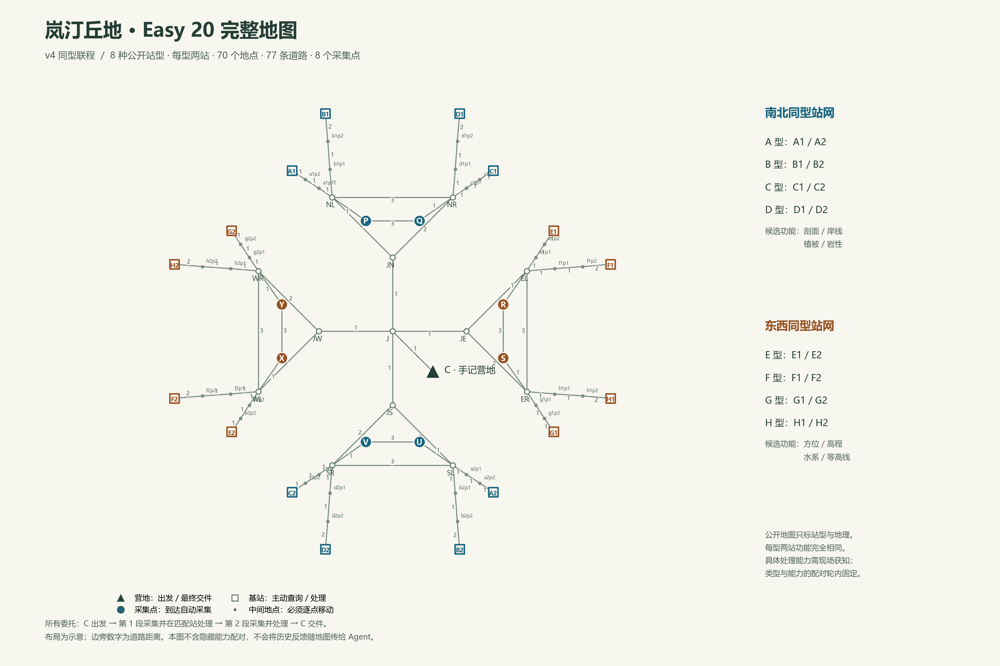

# 岚汀丘地：公开站型与跨地点经验复用

版本 `lanting-easy20-fixed-types-v5`，配置 [station_easy20_reuse.json](../memorybenchmark/data/station_easy20_reuse.json)。站型功能是地图的固定属性；所有 Agent、保留／清除组、重复运行与人类游玩都使用同一套分配。Agent 从一座站获得的反馈，可以适用于远处同型站。v4 的冻结实验与旧版 [联程巡测](EASY20_LINKED_MAP.md) 成绩保留，不能按新提示改写历史。



[可缩放地图 SVG](assets/easy20-reuse/complete-map.svg)、[地图 PDF](assets/easy20-reuse/complete-map.pdf)、[二十项委托图](assets/easy20-reuse/twenty-task-dependencies.png)、[全部经验前序 JSON](assets/easy20-reuse/task-dependencies.json)保留 v4 生成记录；v5 沿用相同地理与委托。旧图中的功能配对示例不作为 v5 实际答案，实际固定分配以网页的完整设计视图为准。地图布局为示意，边旁数字才是道路距离。

## 什么公开，什么需要交互获得

地图共 70 个地点、77 条道路、8 个独立环路。保留营地 C、8 个采集点、16 座处理站；32 个支路中间地点仍要实际移动，不添加虚构通勤边。

| 公开站网 | 公开站型 | 每型的两座物理站 | 公开候选功能，具体配对未知 |
|---|---|---|---|
| 南北站网 | A、B、C、D | A1/A2、B1/B2、C1/C2、D1/D2，分别位于北、南 | 剖面、岸线、植被、岩性 |
| 东西站网 | E、F、G、H | E1/E2、F1/F2、G1/G2、H1/H2，分别位于东、西 | 方位、高程、水系、等高线 |

同型两站功能完全一致。这是初始公开规则，不是必须靠归纳猜出的规律。每个站网的四种功能与四种站型一一对应。具体配对写在宿主地图配置中，地图不因新建实验、切换 Agent、开始下一项委托或重新游玩而改变。修改功能配对必须创建另一个地图版本。

当前固定分配沿用此前 GA、Hermes 与 Hermes 原配置重跑实际共用的 `omega_15_05`；`fixed_world` 只存在于宿主配置中，不进入正常观察。原生实验另记录地图文件与实际站点分配的 SHA-256，便于核对条件一致。入口不再抽样，`--world` 仅能确认固定值；恢复历史运行仍沿用其原记录。

评测侧仍保留两站网各 24 种、合计 576 种相容候选，用来分析未知事实和已交付反馈的信息量。它们是候选假设，不是每次运行可切换的实际地图。若仅保留实际答案一个候选，会错误地把尚未探索的 Agent 当作已经知道全部功能。新实验仍从原生基础记忆开始；固定地图规则不等于开局提供功能答案。

任务只给采集点和资料需求，不写应去的类型或站名。初始与 `read` 地图公开类型和地理，不公开功能配对；`inspect` 或 `process` 才交付当前站的能力、站型与处理结果。同型传播是对已交付反馈应用公开规则，不是评测器给 Agent 自动保存经验。下一 session 不重发此前的站型能力。

例如，在某个世界中 D 型支持剖面。T1 在 D1 成功处理后，Agent 可以自主保存“D 型支持剖面”；后续在南部采集剖面时，就能根据公开地图选择 D2，无须先访问 D2。这个例子不固定 D 的真实能力。[隐藏配对示例图](assets/easy20-reuse/station-type-example.png)仅供人类设计检查，不是实际 Agent 结果。

## 二十项普通委托

每项从 C 出发，两段依次到达目标自动采集、在匹配站处理，最后回 C 提交一次；第一段不需要中途交件。所有任务都是普通委托，没有单独调查或教学阶段。每项新 session 清除对话、临时上下文、位置与资料，仅 Agent 自主管理的持久记忆可跨 session。

| 委托 | 第 1 段 | 第 2 段 | 需求关系 |
|---|---|---|---|
| T1 | P 剖面 | R 方位 | 首次需求，允许自主探索 |
| T2 | U 植被 | X 水系 | 首次需求，也可能复用此前试探反馈 |
| T3 | Q 剖面 | V 植被 | 承接 T1.1、T2.1 |
| T4 | S 方位 | Y 水系 | 承接 T1.2、T2.2 |
| T5 | P 岸线 | R 高程 | 新需求，也可使用已观察或推断的站型信息 |
| T6 | U 岩性 | X 等高线 | 新需求，也可使用已观察或推断的站型信息 |
| T7 | Q 岸线 | V 岩性 | 承接 T5.1、T6.1 |
| T8 | S 高程 | Y 等高线 | 承接 T5.2、T6.2 |
| T9 | Q 剖面 | V 植被 | 整项重复 T3 |
| T10 | S 方位 | Y 水系 | 整项重复 T4 |
| T11 | Q 岸线 | V 岩性 | 整项重复 T7 |
| T12 | S 高程 | Y 等高线 | 整项重复 T8 |
| T13 | U 剖面 | R 水系 | 改到南部／东部采集，组合旧需求 |
| T14 | X 方位 | P 植被 | 改到西部／北部采集，组合旧需求 |
| T15 | V 岸线 | S 等高线 | 改到南部／东部采集，组合旧需求 |
| T16 | Y 高程 | Q 岩性 | 改到西部／北部采集，组合旧需求 |
| T17 | U 剖面 | R 等高线 | 同型站的另一种需求组合 |
| T18 | X 方位 | P 岩性 | 同型站的另一种需求组合 |
| T19 | U 岸线 | R 水系 | 同型站的另一种需求组合 |
| T20 | X 高程 | P 植被 | 同型站的另一种需求组合 |

八种资料和八个采集点各出现五次；40 段中 32 段有更早的同类处理需求。任一前序段成功处理，便获得一种匹配站型的实际反馈，后续可将其用于两座同型站。这里不要求前序整封委托成功，也不保证 Agent 保存或使用经验。没有成功处理时，仍按实际查询与失败试探的反馈判断机会，不补课、不注入答案。此表是固定任务流，任务不会随 Agent 的选择改写。

## 轨迹与评测记录

每次移动仍是独立有向边，保留顺序、段编号和成本；查询、处理、提交为节点事件。新增分析分别记录：

- 计划中的同类需求前序，及此前真正收到的反馈来源事件。
- 直接观察过的匹配站型、其所有同型实例、此前没去过的匹配实例。
- 未直接观察某站型、但可由一一对应规则推断的匹配站，和直接观察分开。
- 首次支路选择、是否曾去过该物理站、是否是已观察类型的新实例，以及选择前本 session 是否重新调查。

在 A1 获得反馈、随后首次选择 A2，会留下跨地点应用的证据链。选择正确站本身不证明内部记忆使用，仍需结合实际原生记忆输入和保留／清除对照。两分支的评测侧历史相同，不表示清除分支收到过旧反馈。未走到的段保留空选择，不补造错误或剔除任务失败。

网页 `/easy20` 的“手记与地图 → 查看完整设计图”是显式的人类检查入口，展示本轮真实配对、完整任务与经验来源；原生 MCP 接入没有这个入口。正常游玩和 `read` 不增加历史能力记录。

## 数量与预算

Easy 先保留 8 种站型、16 座站，不按地图节点数增加记忆事实。扩大地图时可添加同型实例，先让已有经验在新地点有用。每个站网最多实际观察三种站型，就可由公开的一一对应规则确定第四种；因此这是一张小规模记忆复用地图，不能用它独立验证大容量记忆或长期干扰能力。若正式研究需要持续的新经验和容量压力，应另设更多站型／地图的实验条件，不能仅把 20 项机械加长。

[数量检查](assets/easy20-reuse/type-count-review.json)穷举同一反馈策略的 576 个世界：144 个世界在 T1 后、256 个在 T2 后、176 个在 T5 后，已有反馈足以确定全部站型配对。中位数是 T2。这是评测器的相容世界判断，不表示真实 Agent 已保存或用好了这些信息。八种站型足够验证 Easy 的复用机制，但不适合宣称二十项中持续获取大量新知识；后续应先用真实 Agent 验证，再决定是否另增站型条件。

新版最多 88 次游戏操作；原生主循环预算仍为 100 次模型调用，另有同 session 的 6 次收尾调用与 3,600 秒时限。增加游戏预算是因为四种候选站型的完整逐型试探可能超过旧版 72 次，避免清除对照因结构预算无法完成。测试覆盖的逐型查询策略最坏 81 次，仍不保证任意无目的闲逛都完成。

此前 v4 的[调用前冻结计划](assets/easy20-reuse/hermes-run-plan.json)记录了当时的源码、配对选择和预算，属于历史实验条件。v5 固定地图与明确的跨 session 规则是新条件；本次修改没有重跑真实模型实验。后续仍检查实际站型反馈、未访问同型实例的选择、自写记忆的交付和清除对照，不把正确选择单独当作记忆使用证明。

已有脚本验证与图仅用于检验规则、信息结构和可行性，不是模型成绩，不作为 D1–D4 的完整分数。

## 软件与公网验收

v5 固定地图的 205 项服务器回归通过，四次人类服务启动、两次实际文字入口启动使用相同配对。固定配对与最近 GA、Hermes、Hermes 原配置重跑的实际分配逐项相同，地理与委托也一致。四十个保留／清除规则会话完成真实内核重放；GA 与 Hermes 的原生循环均收到明确的固定地图规则，旧随机措辞和宿主配对标记没有进入实际首轮模型输入。原生检查使用固定响应与主动放弃，仅验证接入和提示，不计为能力成绩，真实模型调用为 0。见[本次验收记录](assets/fixed-map/validation.json)。

实现提交 `30c7db1` 已部署 Squishy。[验收记录](assets/easy20-reuse/deployment-validation.json)包括服务器 184 项回归全部通过、[Windows／Linux CI](https://github.com/dd3xp/memorybenchmark/actions/runs/40920870608)通过，以及 GA／Hermes 实际原生循环中的脚本接入检查。两套适配均完成两段同 session 与最终提交，29 次操作／距离 30；公开站型与现场类型反馈已进入模型请求，使用的是脚本模型而非真实模型能力实验。

公网按正常证书校验和 PIN 登录完成全部 20 项／40 段人类参考流程，下一项操作日志重置、回营交件与最终任务流结束均通过；该流程使用显式人类设计视图作为软件 QA 参考，不是自主探索。未登录接口返回 401。浏览器另核对普通地图 16 座站的类型标签、完整图 70 节点、8 张类型卡、20 行委托，以及实际 C→J 移动。鉴权、180 天有效期、TLS 与隧道配置未改变。旧版 GA 在其冻结的独立运行中继续，不与本版混算。

## 复现

```powershell
python -m scripts.build_easy20_reuse_map
python -m scripts.check_easy20_reuse --output .runs/typed-check --public-output docs/assets/easy20-reuse
python -m scripts.render_easy20_reuse --output docs/assets/easy20-reuse
python -m memorybenchmark.prototypes.station_session --design memorybenchmark/data/station_easy20_reuse.json --human --all-tasks
```

原生接入继续使用相同 MCP 和薄适配器，启动新运行时传入 `--design memorybenchmark/data/station_easy20_reuse.json`。原生探针、冻结源码、基础库恢复与配对边界沿用原协议；旧运行继续使用各自冻结的地图和实现。
