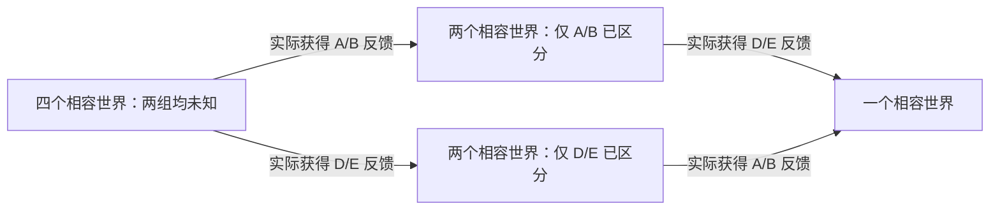

# 多项经验的逐步获得与跨任务利用

更新：2026-10-25。独立机制原型 v2：10 地点、9 条通路、两组独立能力、4 个匹配世界、8 项普通委托。已完成有限参考搜索、真实规则重放与文字试玩入口；尚未运行真实 Agent，也没有替换线上雾汀湖。

这一版沿用 [首个局部能力样例](STATION_CAPABILITY_PROTOTYPE.md) 的操作规则，增加的是**彼此独立、可以分别获得的信息**。不增加天气、危险、装备、背包或复杂路线优化。完整游戏玩法与测量指标仍未冻结。

## 环境现在能表达什么

两座站 A/B 分别支持剖面与岸线资料，两座站 D/E 分别支持方位与高程资料。每组恰好各一站支持一种，具体分配未知；两组分配相互独立，跨任务保持不变。公开的是候选能力范围，实际分配只由查询或处理反馈揭示。

世界生成器组合两组分配，得到四个等权参考世界。它们的公开地图、当前任务与初始状态一致。地理仍完整公开，以隔离路径记忆；所有站与目标都通过岔口 J 连接，设施支路距离 2，营地和目标支路距离 1。每任务只采集一个点的一种资料，知道对应设施以后执行很直接。

| 内容 | 保持方式 |
| --- | --- |
| 未知设施能力 | 同一世界跨所有委托稳定；两组独立 |
| 当前目标、需要的资料 | 本次公开；下次可以改变地点和种类 |
| 位置、原始资料、处理状态、操作与时钟 | 每委托重置；旧资料不能替代本次采集 |
| 历史反馈 | 不在新 session 重发，不写入公共地图 |
| Agent 经验 | 正式条件应由 Agent 自己保存、读取；目前只做设计校验 |

动作仍为 `move`、`inspect`、`process`、`submit`、`abandon`。到目标自动采集；查询与处理返回实际能力；不支持的处理保留原始资料。每任务 16 次操作，从营地出发并回营提交。新版本复用同一规则引擎，v1 的单组样例继续通过校验。

## 现在有真正的部分信息状态

校验器按实际已交付反馈维护相容世界集合 `K(H)`，不把访问、成功、失败或作者的预期经验当成知识标签。查询 A 后可排除 A/B 的另一种分配，但 D/E 仍有两种可能；再查询 D 才能区分完整分配。



**相容世界数不是记忆分数。** 同样剩两个世界，历史对当前任务的价值可能不同。以下数字是四世界均匀先验下、要求全部可成功的最小期望通勤距离；不是被测 Agent 的成绩。

| 实际历史 | 相容世界数 | 当前需 A/B 时：历史参考／无历史参考 | 当前需 D/E 时：历史参考／无历史参考 |
| --- | ---: | ---: | ---: |
| 到过站但未查询或处理，随后放弃 | 4 | 10／10 | 10／10 |
| 查询 A 后放弃 | 2 | 8／10 | 10／10 |
| 查询 D 后放弃 | 2 | 10／10 | 8／10 |
| 两组都查询过，随后放弃 | 1 | 8／10 | 8／10 |
| 完成一次 A/B 类普通委托 | 2 | 8／10 | 10／10 |
| 完成 A/B 类委托，途中额外查询过 D | 1 | 8／10 | 8／10 |

这确认了三件设计性质：只获得一组信息不会自动补全另一组；失败仍可能留下有用证据；未获证据的后续任务仍可现场调查完成。任务失败不会强制截断后续委托，也不补发作者经验。

参考策略使用公开状态、剩余预算和实际证据相容的世界，不能读取运行时真正的世界编号。未知时需要选择与查询；已知时直接访问对应站。精确搜索包含所有合法反馈策略，先最小化本次期望距离，再以期望操作数打破平局，不为探索环统一打好坏标签。

## 八项委托只是一个可执行目录

任务不标记“收集经验”或“测试记忆”。下表是默认目录顺序下，历史参考策略的实际反馈演变；反序和另一交错顺序也已重放。另有普通任务中主动查询另一组的例子，因此信息来源不绑定某个固定任务编号。

| 委托 | 测绘目标与资料 | 执行前后相容世界数 | 历史参考平均距离 | 当前无历史分支平均距离 |
| --- | --- | --- | ---: | ---: |
| T1 | P，剖面 | 4 → 2 | 10 | 10 |
| T2 | Q，岸线 | 2 → 2 | 8 | 10 |
| T3 | R，方位 | 2 → 1 | 10 | 10 |
| T4 | Q，剖面 | 1 → 1 | 8 | 10 |
| T5 | S，高程 | 1 → 1 | 8 | 10 |
| T6 | S，方位 | 1 → 1 | 8 | 10 |
| T7 | P，岸线 | 1 → 1 | 8 | 10 |
| T8 | R，高程 | 1 → 1 | 8 | 10 |

T2 已经使用第一组历史时，第二组仍未知；T3 才因当前正常处理获得第二组信息。这种先后由实际访问和反馈决定。若 T1 没有接触能力反馈，T2 的信息条件就不同；若 T1 顺路查询 D，则 T3 可能已有相关信息。

可直接查看生成的 [八项委托执行概览图](assets/station-capability-v2/overview.svg)。

无历史列是**从同一实际历史检查点分出的当前任务对照**，不是一个独立 Agent 连续跑八项的全程轨迹，不能把它求和冒充全程 NOMEM 成绩。每个后续主线检查点延续历史参考分支的真实执行；清除分支不回写主线。

## 人与程序使用相同规则

在仓库根目录启动终端试玩，默认随机选择一个世界，并在这次进程的所有委托间保持：

```powershell
python -m memorybenchmark.prototypes.station_session --human --all-tasks
```

输入 `move J`、`move P`、`inspect`、`process`、`submit`、`abandon`、`read` 或 `quit`。每步返回当前委托、资料状态、可走道路和实际反馈。人类模式可连续八项；人的终端历史没有被当成受控的 Agent 记忆实验。

程序侧为当前任务范围的 JSON Lines：

```powershell
python -m memorybenchmark.prototypes.station_session --task T1
```

```json
{"command":"read"}
{"command":"action","request_id":"move-1","expected_revision":0,"action":{"type":"move","target":"J"}}
```

只接受 `read` 和当前任务动作，不提供开始下一项、世界真值、历史事件、快照或文件读取。每次操作返回简短任务要求与结构化观察；相同请求重发不重复执行，过期版本拒绝；旧任务连接在宿主切换任务后关闭。stdout 只输出协议 JSON。

`--world` 是宿主重现匹配世界用的私有参数，不能给被测 Agent 当提示。单任务进程默认重新抽样；真正跨 session 实验需要宿主保持同一世界并管理记忆隔离。此入口尚未接入正式 MCP 服务或 GA 生命周期，不能据此宣称已完成原生 Agent 评测。试玩日志保存在私有 `.runs/station-play/`，不通过工具提供。

## 验证和复现

配置：[station_capability_v2.json](../design/station_capability_v2.json)；多项经验校验：[check_experience_stream.py](../scripts/check_experience_stream.py)；文字适配器：[station_session.py](../memorybenchmark/prototypes/station_session.py)。

```powershell
python -m unittest discover -s tests -p "test_station*.py" -v
python -m unittest discover -s tests -p test_experience_stream.py -v
python -m scripts.check_experience_stream --output .runs/experience-stream-review-new
```

输出目录必须是新的，包含生成后的完整私有世界快照、源码哈希、原始反馈、通勤图 JSON、节点事件、SVG 和汇总 Markdown。已通过 23 项针对性测试、96 条历史矩阵分支及 192 条任务流分支重放，共 288 条当前任务参考轨迹；另完成真实子进程 JSONL 和八任务终端入口验收，没有调用模型 API。

## 这一步确定了什么

现在不需要靠复杂路线优化，就能表达多项独立信息、只获得部分信息、信息与当前目标的相关性，以及失败后的再次探索。轨迹仍由自然移动生成，操作和反馈关联地点，旧的表示校验继续成立。

本版仍属于**一种经验类型的多项事实**；部分信息是对独立事实的部分覆盖，不是模糊线索融合。没有证明一般方法记忆、经验抽象或迁移，也没有验证真实 Agent 会怎样主动整理和检索。完整玩法暂采用局部能力机制作为工作候选；先在这个信息结构上接入原生 Agent，观察实际行为，再决定是否需要另一种机制，而不继续靠加设施数量增加难度。八项目录也不是最终地图或正式数据集。
