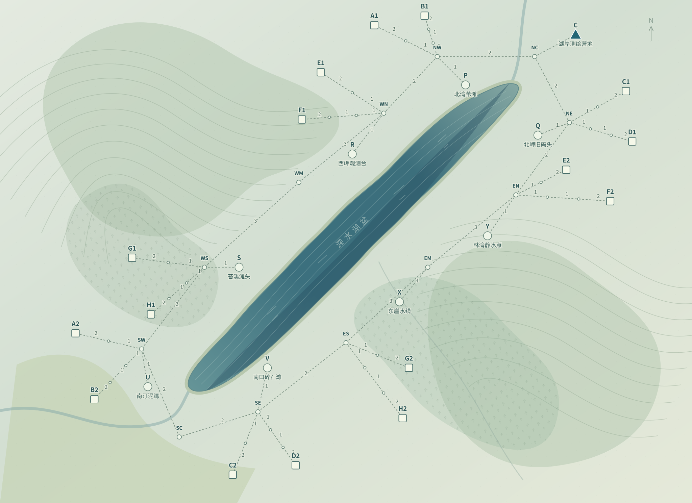

# 尼斯湖水怪

第一张正式 Easy 地图，地图标识 `nessie-easy`，规则版本 `nessie-easy-1.0`。包含 61 个地点、61 条道路、8 个踪迹调查点、8 种站型、16 座基站和 20 项双段委托。已部署 Squishy，完成规则、信息边界、任务流与网页验收；原生 Agent 的难度校准另行运行。



配置：[nessie_easy20.json](../memorybenchmark/data/nessie_easy20.json)。旧岚汀丘地图及全部冻结实验保留，不能把两张地图的成绩混算。

## 地形与命名

保留尼斯湖西南—东北的狭长湖盆、两条岸侧通路及林地支路作为骨架。西岸山岭与东岸林地的地景依据来自 [BGS Invermoriston 地质说明](https://webapps.bgs.ac.uk/Memoirs/docs/B01912.html)、[Forestry and Land Scotland 的大峡谷林地](https://forestryandland.gov.scot/visit/forests-by-region/forests-in-the-great-glen)与 [Farigaig 林地步道](https://forestryandland.gov.scot/visit/destinations/farigaig)。

湖体、林地和等高纹理为自行绘制的地形示意。地点名称、营地、基站、道路、距离和功能配对均为游戏设计，不对应现实设施或徒步路线。地图标题按用户要求使用“尼斯湖水怪”，节点名称仍虚构；现实地名和研究来源不进入 Agent 的地图或任务。踪迹是游戏调查材料，不预设现实中存在水怪。

两岸只在湖的两端连接，湖面没有横穿道路。主路构成一个环，基站分布在支路末端；全部中间节点需要真实移动。地图和基础距离从 T1 起公开，自由探索，不按任务锁区。

## 跨 session 需要复用的经验

任务要求调查并研判指定踪迹。公开信息包含候选能力和站型位置；具体“站型 → 支持哪类踪迹”通过现场 `inspect` 或 `process` 得到。

| 公开站网 | 站型 | 候选踪迹 | 同型实例 |
| --- | --- | --- | --- |
| 踪迹勘测站网 | A、B、C、D | 异常尾流、岸边压痕、折苇痕迹、附着物样本 | 每型两座，分别分布于湖的北端和南端 |
| 信号研判站网 | E、F、G、H | 水下回声、远距影像、热源记录、岸侧振动 | 每型两座，分别分布于西岸和东岸 |

同型一致与各站网内的一一对应关系是公开规则，字母不暗示功能。配对是地图的固定属性，所有 Agent、记忆条件、重复实验与人类游玩完全一致；候选世界仅供评测器区分未知事实与已获得的信息，不作运行时随机分配。

到目标自动采集本段踪迹；匹配研判后进入下一段；两段完成后只能回 C 营地交付。错误研判保留踪迹并反馈实际能力，查询和研判各消耗一次操作。当前段资料、位置、对话与工作记忆在任务边界重置，只有 Agent 自主管理的持久记忆跨 session。公共地理图不附送旧能力反馈。

前序整项失败不抹去已经交付的经验，也不补发没有经历过的经验。评测记录实际反馈来源、同型传播、逻辑推断、首次支路选择、当场重新查询及通勤成本。

## 二十项委托

每项从 C 出发，按顺序完成两段后回 C 交付一次。八种踪迹各出现五次，40 段中 32 段有更早的同类研判需求。T1、T2 都是普通任务，首次需求仍可受此前自由探索影响。任务流不随 Agent 的选择或失败改写。

| 委托 | 第 1 段 | 第 2 段 |
| --- | --- | --- |
| T1 北湾异常 | P 异常尾流 | R 水下回声 |
| T2 南汀折苇 | U 折苇痕迹 | X 热源记录 |
| T3 双岸尾流 | Q 异常尾流 | V 折苇痕迹 |
| T4 两岸回声 | S 水下回声 | Y 热源记录 |
| T5 浅滩压痕 | P 岸边压痕 | R 远距影像 |
| T6 浮屑复核 | U 附着物样本 | X 岸侧振动 |
| T7 岸边印记 | Q 岸边压痕 | V 附着物样本 |
| T8 夜影核查 | S 远距影像 | Y 岸侧振动 |
| T9 尾流再访 | Q 异常尾流 | V 折苇痕迹 |
| T10 回声复测 | S 水下回声 | Y 热源记录 |
| T11 压痕复查 | Q 岸边压痕 | V 附着物样本 |
| T12 夜影再访 | S 远距影像 | Y 岸侧振动 |
| T13 南湾追踪 | U 异常尾流 | R 热源记录 |
| T14 东岸芦影 | X 水下回声 | P 折苇痕迹 |
| T15 跨岸对照 | V 岸边压痕 | S 岸侧振动 |
| T16 北湾残留 | Y 远距影像 | Q 附着物样本 |
| T17 南汀异响 | U 异常尾流 | R 岸侧振动 |
| T18 东岸浮屑 | X 水下回声 | P 附着物样本 |
| T19 压痕与热迹 | U 岸边压痕 | R 热源记录 |
| T20 影像与折苇 | X 远距影像 | P 折苇痕迹 |

T9–T12 是四项完整行程的重复；T13–T20 将已有需求换到其他调查点并重新组合。匹配站不由委托指定，Agent 可以在两个同型实例中选择，也可以自由查询其他站。完整来源计划见[逐段经验前序](assets/nessie-easy/task-dependencies.json)；实际可用经验仍以该 Agent 已收到的反馈为准。

## 游玩、设计查看与接入

- `/maps?id=nessie-easy`：完整公开地图，可开启经验点标记。
- `/play?map=nessie-easy`：点击相邻节点移动，调查、查询、研判与回营交付。
- `/play?map=nessie-easy&inspect=1`：显式人类设计查看，包含真实配对、全部任务和经验来源；不改变进度，不进入 Agent 观察。

游玩页默认打开新图；`/easy20` 与旧地图链接继续打开原型。人类和 Agent 使用同一个 `StationGame`、`StationSession` 和现有 MCP 通路，无需修改 GA／Hermes 的原生工具或记忆。

```powershell
python -m memorybenchmark.prototypes.station_session --design memorybenchmark/data/nessie_easy20.json --human --all-tasks
python -m scripts.build_nessie_easy_map
python -m scripts.render_nessie_easy --output docs/assets/nessie-easy
python -m scripts.check_nessie_easy --output .runs/nessie-validation-new
python -m unittest tests.test_nessie_easy -v
```

原生独立运行器继续使用 `memorybenchmark.prototypes.station_independent`，传入 `--design memorybenchmark/data/nessie_easy20.json`。保留／清除组各自独立运行完整 20 项，T1 单列；操作预算 88，原生主循环 100 次调用、同 session 收尾 6 次、总时限 3,600 秒。新图启用时从各 Agent 的原始基础记忆开始。

## 校验

服务器 249 项回归全部通过，无跳过；公网 HTTPS 与原有 PIN 鉴权通过。通过真实网页点图完成 T1（27 次操作、路程 36），再以独立人类 QA 实例从公网逐动作完成全部 20 项，核验自动调查、匹配研判、营地交付、动作重放幂等和任务间重置。旧实验索引与八个冻结清单文件未改变。详见[部署与游玩验收](assets/nessie-easy/deployment-validation.json)。

[软件与信息结构校验](assets/nessie-easy/validation.json)穷举 165,888 组兼容站型顺序，并把各项最坏情况在真实规则内核重放；该策略最坏 85 次操作。576 个候选配对下的两种反馈策略共 23,040 次模拟完成，实际固定配对另做 40 次真实内核重放，覆盖完整保留和清除流程。

这些是规则可行性与信息价值校验，模型调用为零；不能当作 GA／Hermes 的记忆收益或路线 GT。八种固定配对用于 Easy 的获取与复用实验，容量和长期干扰需另设条件。
