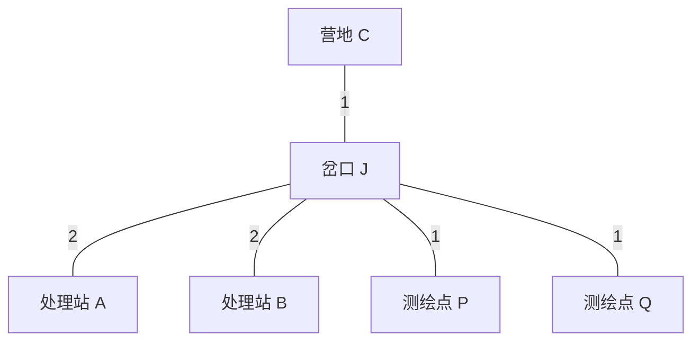
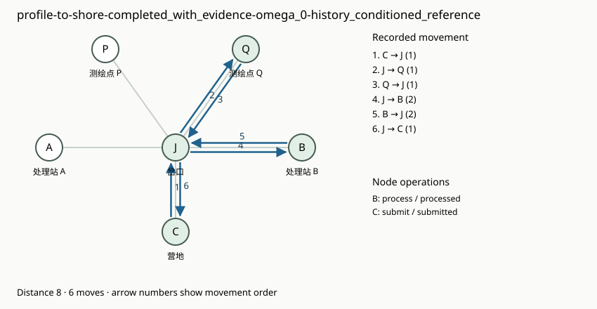
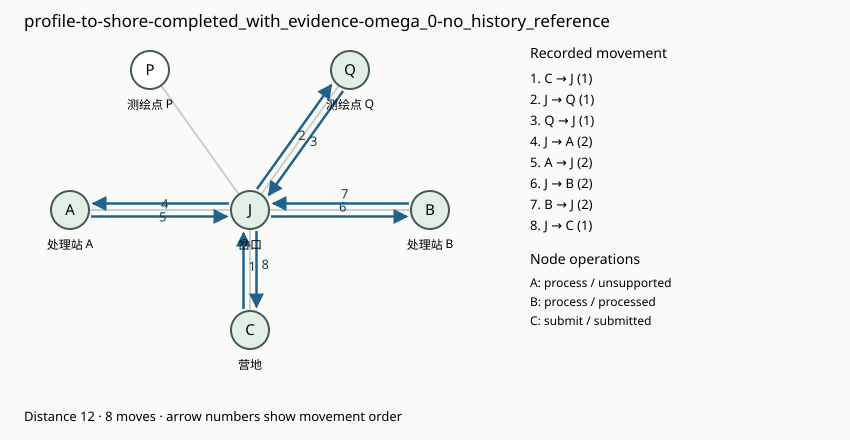

# 局部设施能力：首个可执行机制样例

更新：2026-10-25。状态：独立原型及参考校验已完成；尚未选定完整游戏玩法，没有接入或运行真实 Agent。该样例不注册为游戏场景，不替换已发布的雾汀湖。

本样例落实 [环境重设计范围](ENVIRONMENT_REDESIGN.md) 与 [问题建模方法](../reports/记忆环境%20重设计%20问题建模.md)：先验证一项稳定未知信息怎样由行为获得、怎样影响另一次任务，再考虑地图和委托流。

后续扩展：[多项经验原型 v2](MULTI_EXPERIENCE_PROTOTYPE.md) 已增加两组独立能力、部分信息、八项普通委托和文字试玩入口。下文保留单组机制的基线与几何检查。

## 为什么先选择局部能力

三个候选中，单纯“记住哪个按钮有效”可能不改变通勤结构；加入条件对应会增加推断负担。这里先选择**地点的处理能力**：地理位置公开，能力分配未知；实际查询或试用揭示能力，之后可以直接前往需要的站点。信息改变访问地点和顺序，不需要比较几条相差很小的路线。

这是一项世界特定事实的最小检验，不代表最终环境只考察地点目录，也不代表已经覆盖更复杂的经验。没有增加危险、工具、体力、天气或背包系统。

## 一页环境契约

| 项目 | 规则 |
| --- | --- |
| 公共地理 | 六个地点：营地 C、岔口 J、处理站 A/B、测绘点 P/Q。五条路均可双向通行；C—J、J—P、J—Q 距离为 1，J—A、J—B 为 2 |
| 持久未知量 θ | 两站中一站支持剖面资料，一站支持岸线资料；两种分配构成两个世界，在同一世界内跨 session 保持不变 |
| 初始公开知识 | 完整地理图、操作规则、当前委托，以及“两类能力恰好各一站”这一规则；具体分配不公开 |
| 当前短期状态 | 所在地点、是否采集本次原始资料、是否完成处理、操作数、累计距离、完成状态；这些状态均可见 |
| 委托 | 剖面委托到 P 采集剖面资料；岸线委托到 Q 采集岸线资料。均需到支持本站资料的处理站处理，再回 C 提交 |
| 移动 | `move(target)` 只沿相邻道路移动。到本次目标自动获得原始资料；到站不自动揭示能力 |
| 查询 | 在站内 `inspect` 返回实际支持的资料种类，不改变资料状态 |
| 处理 | 带有本次原始资料时在站内 `process`。返回本站能力和本次处理结果；不支持时保留资料，可去另一站重试 |
| 提交 | 仅在 C 使用 `submit`；本次资料已采集并处理才成功。未准备好时返回未完成，不能借用上一委托成果 |
| 放弃与预算 | 可随时 `abandon`；每项委托最多 16 次操作，耗尽后失败。最后一次操作产生的反馈仍实际交付 |
| 成本 | 每次操作占一次预算。移动累计真实道路距离，查询、处理、提交各耗时 1；失败处理不另加人为罚分 |
| 任务边界 | 地点回 C，原始资料、处理状态、计数、时钟和临时上下文重置；设施能力保持。环境不向新 session 重发历史反馈 |
| 信息隔离 | 公共观察不含 θ、世界编号、能力表、历史日志或评测器的相容世界集合；日志只供分析端使用 |
| 自主记忆 | 正式被测条件应由 Agent 自己保存和读取经历。本样例尚无 Agent，参考策略使用实际反馈计算信息状态，只用于设计校验 |

为隔离这项经验的作用，样例一开始就公开全部六地点，不模拟地图迷雾；两分支的地理信息相同，收益来自能力信息。正式游戏的地图点亮协议未改变。



## 两个匹配世界与证据

| 私有世界 | A 的能力 | B 的能力 | 当前公开地图与委托 |
| --- | --- | --- | --- |
| omega_0 | 剖面 | 岸线 | 与另一世界一致 |
| omega_1 | 岸线 | 剖面 | 与另一世界一致 |

世界编号只在校验材料中出现。常识、地名、左右偏好和当前目标都不能直接告诉 Agent 分配；一个固定选择会在其中一世界猜中，在另一世界需要重新调查。查询或实际处理的反馈是信息来源；到过站但没有查询或处理，不算接触过能力信息。

校验器以 `K(H)` 表示与**实际已交付反馈**相容的世界集合，不能用私有真值或额外日志注释替 Agent 补知识。由于本样例只有一个确定性的二值未知量，信息状态只有两类：尚不能区分两个世界，或已由反馈区分。这里没有“缩小后仍含多个世界”的中间知识状态，不能宣称已验证部分知识推断。

两个委托都可以先执行，校验同时覆盖“剖面→岸线”和“岸线→剖面”。完成任务所需的处理本身会揭示信息；查询也是自由行动。没有单独强制的经验收集任务。这个极小世界只容纳一项未知量，持续积累多项经验留待后续机制扩展。

## 信息价值的校验结果

参考求解器在完整公开状态、实际可用的候选世界和剩余预算上穷举合法反馈策略；**看不到运行时真正的世界编号**。均匀先验下先最小化期望通勤距离，再以期望操作数打破平局；要求每个候选世界都能在预算内提交成功。随机混合不能改善此期望目标，因此确定性反馈策略搜索已足够用于这项有限检验。

| 真实前史 | 按已交付历史计算的参考策略平均距离 | 无历史参考策略平均距离 |
| --- | ---: | ---: |
| 完成前项委托，实际处理得到能力反馈 | 8 | 10 |
| 前项委托放弃，但曾查询能力 | 8 | 10 |
| 前项委托到过站后放弃，未查询或处理 | 10 | 10 |

两种委托顺序都得到同样结果。历史条件与无历史条件从同一实际历史检查点分支，开始时当前状态、目标和公开观察相同；区别仅是参考规划是否利用历史已交付证据。

这组数字还有一个独立的几何解释：营地、目标点和正确处理站均需往返，已知能力时距离为 `2×(1+1+2)=8`。不知道分配时，先访问的站在两世界中各有一半机会不适用；再访问另一站额外增加 `2×2=4`，故最优期望为 `8+4/2=10`。无历史策略在两个世界实际走出 8 和 12，均成功。

把营地支路距离改为 1/3、目标支路改为 1/4、两站支路同步改为 1/2/5，共 12 组几何、24 组任务检查，精确搜索与实际规则重放均符合：已知距离 `2(c+f+d)`，未知最优期望再增加 `d`。信息价值不依赖某一组微小成本偏好反转。

已执行校验：24 条匹配分支重放、4 条表示检查轨迹、24 组任务／道路长度检查（其中 48 次无历史策略重放），以及 8 项针对性单元测试。没有调用模型 API。它证明的是这个有限机制内的信息价值与执行可行性，**不是 Agent 已经学会、记住或复用了信息**。

## 轨迹图保留什么

每次移动复用现有 `commute_graph` 导出独立有向边，保留顺序、距离和时间；查询、处理及反馈另作节点事件。下面两图来自同一世界、相同历史检查点后的岸线委托，均成功；一个利用历史证据直达 B，另一个先尝试 A，再到 B。





另外两条表示检查更接近我们想保留的过程信息：先去 A 查询再采集，或先采集再去 A 试处理，最后都到 B 完成。这两条都成功，均为 12 距离、8 次移动、11 次操作，连无标签的有向边重数都相同；**访问顺序和节点事件不同**。相关图见 [先查询](assets/station-capability/early-query.svg) 与 [后试用](assets/station-capability/later-trial.svg)。不据此判定哪条更好，也不宣称其中某条使用了跨 session 记忆。

还有一对相同移动序列的轨迹，只相差在 B 额外查询一次：距离和地理拓扑相同，操作数与后续时间不同。它说明仅保存无标签图会丢信息。图的确能保留不同过程；后续仍需验证哪些过程值得测量，不能将此直接当作最终图指标的效度证据。

## 复现与下一步

配置：[station_capability_v1.json](../design/station_capability_v1.json)；独立规则与精确参考搜索：[station_capability.py](../memorybenchmark/prototypes/station_capability.py)；校验与图导出：[check_station_capability.py](../scripts/check_station_capability.py)。在仓库根目录运行，输出目录必须是新的：

```powershell
python -m unittest discover -s tests -p test_station_capability.py -v
python -m scripts.check_station_capability --output .runs/station-capability-review-new
```

输出包括配置快照、源码哈希、完整 JSONL 交互、图 JSON、SVG、汇总 Markdown 与 `report.json`。这些文件属于评测侧材料，不能作为下一 session 的额外经验输入。本样例尚无安全隔离的 Agent 接入，不是可直接投放给 Agent 的正式场景。

上述部分信息扩展已由 [多项经验 v2](MULTI_EXPERIENCE_PROTOTYPE.md) 落实，并提供文字试玩。完整游戏的任务质量、操作集合和正式八项委托仍未冻结；尚未进行真实 Agent 的自主记忆实验。
