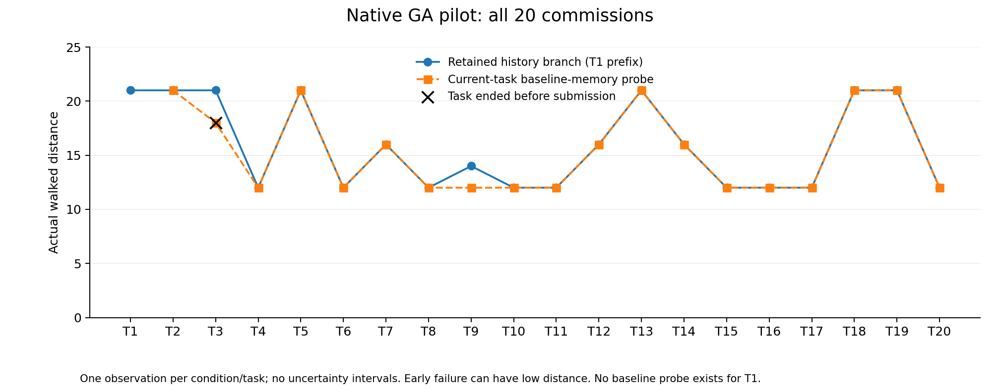
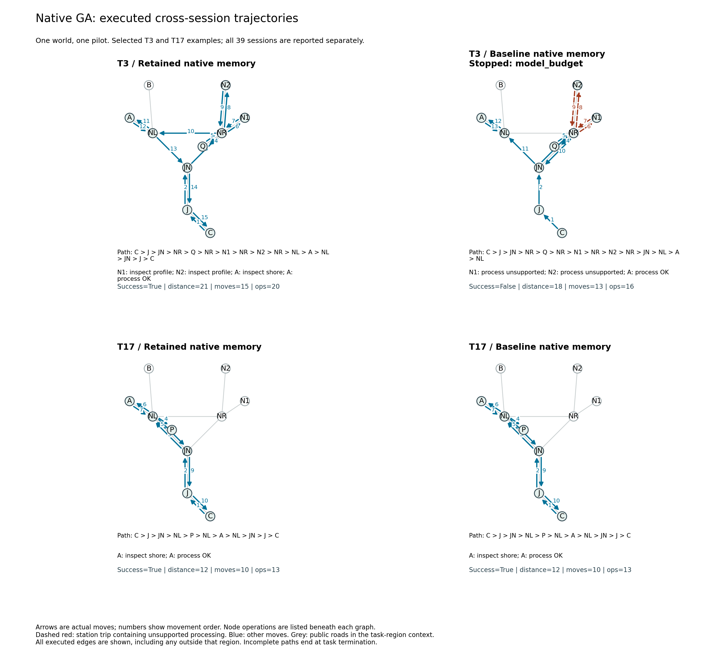
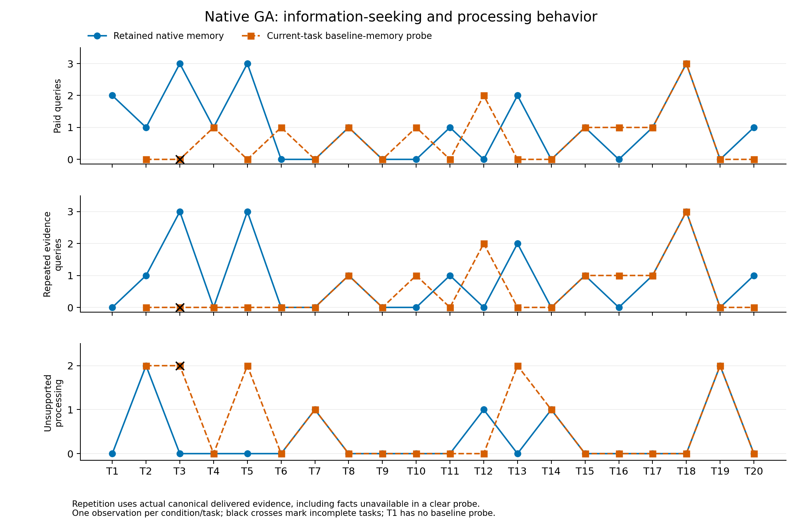

# 四站巡测 Easy20：原生 GA 完整试跑

日期：2026-10-27（纽约时间）。地图 `lanting-easy20-choice-v2`；冻结运行源码 `e0bc252`；原生 GenericAgent；网关模型别名 `gpt-5.6-luna`。

**20 项主线全部成功，19 个当前任务清除记忆对照成功 18 项，共 1,161 次模型调用。GA 的 20 次采集后首次进站中，19 次选择地理最近站；唯一例外 T9 先读取自主经验、选择了匹配但更贵的 E2。** 这轮已经能区分保存、读取、匹配选择与路线成本，尚未形成稳定的记忆收益证据。

## 完整执行结果

地图有 38 个地点、45 条带权道路、四组各四座候选站，每种资料两座匹配站。每个 session 从营地 C 开始，到目标自动采集，处理后返回 C 提交。本轮没有采集前进站；下表“首站”指采集后、处理成功前首次进入本任务候选站群。“最近”按公开道路的最短带权距离计算，不按屏幕直线距离判断。

|执行范围|成功|距离|实际通勤|游戏操作|inspect 查询|不支持的 process|模型调用|
|---|---:|---:|---:|---:|---:|---:|---:|
|主线 T1–T20|20/20|317|241|308|20|7|589|
|clear T2–T20|18/19|291|224|285|12|12|572|
|18 对双方均成功任务：主线|18/18|275|211|269|15|7|523|
|18 对双方均成功任务：clear|18/18|273|211|269|12|10|526|

T1 为共同初始前缀，没有 clear。总计 593 次实际游戏操作，其中 465 次移动、128 次节点操作；模型调用分为 975 次主阶段和 186 次额外整理。另有 8 个被拒绝的游戏请求，单独保留，不伪造移动边或计入已执行操作。

唯一失败为 **T3 clear**：原始资料已处理，在 NL 用尽 40 次主阶段模型调用，未回营提交；只有 16 次游戏操作，未触及 24 次游戏预算。距离 18 是停止前的已走距离，不能解释为比成功主线的 21 更有效率。双方成功子集仅作描述，全部失败仍进入逐项表和总图，不据此作总体因果估计。

下面“已存事实”是人工核对的输入经验文件中的能力事实，结合公开数量规则可推出的状态，**不代表模型已经读取或相信这些事实**。未明保留为未明；不借助未交付的隐藏答案补全。T3 clear 之外均成功。

|委托|主线距离|clear 距离|主线首站|已存事实对该站的判定|进站前读游戏经验|
|---|---:|---:|---|---|---|
|T1|21|—|A|未明|未见|
|T2|21|21|D|未明|未见|
|T3|21|18（未提交）|N1|不匹配|未见|
|T4|12|12|F|未明|未见|
|T5|21|21|E1|不匹配|未见|
|T6|12|12|H|未明|未见|
|T7|16|16|S1|未明|未见|
|T8|12|12|N1|匹配|未见|
|T9|14|12|E2|匹配|是|
|T10|12|12|S1|未明|未见|
|T11|12|12|D|匹配|未见|
|T12|16|16|F|未明|未见|
|T13|21|21|D|不匹配|未见|
|T14|16|16|W1|未明|未见|
|T15|12|12|F|匹配|未见|
|T16|12|12|W1|未明|未见|
|T17|12|12|A|匹配|未见|
|T18|21|21|H|不匹配|未见|
|T19|21|21|A|不匹配|未见|
|T20|12|12|H|匹配|未见|

## 自主记忆与行动怎样接上

Agent 在 **14 项主线委托后**新增或修改经验，共 15 个文件级内容变化：T1 创建 `lanting_survey_game_sop.md` 并把文件名加入原生 `global_mem_insight.txt`，其后持续追加。能力条目没有被覆盖删除。末尾有 14 条显式站点能力事实，结合公开计数可确定全部 16 站；这不等于后续每项都调用了它们。

T1 保存 A/B=岸线、N1/N2=剖面；T2、T5 保存 DE 组；T6 保存 H=水系；T10 保存 S1=植被；T12 才保存 F=植被、G=岩性；T16 追加 W1=水系；T18 追加 W2=等高线。其他若干更新重复事实、补充当前路线。16 项主线开始前收到过同组反馈，14 项输入文件至少含一条同组能力事实。T7、T10 是“有相关历史反馈但没有保存该组事实”；T12、T16 虽有同组笔记，首站能力仍不能由当时已存事实确定，不能把部分知识当成完整知识。

**T3、T5、T13、T18、T19 的首站，均已能由此前保存的事实判定为不匹配；五项在决策前都没有经验检索。** 例如 T3 需要岸线，T1 文件已记录 N1/N2 为剖面，但 Agent 仍先查询 N1、N2，再去 A；实际距离 21。按这些已有事实可直接选 A，条件化直接完成距离为 15。这是保存后未调用的材料，不能归成从未获得经验。

**T9 是确切的经验交付案例。** 首个原生模型调用选择读取自己写的 SOP，第二次实际转发输入包含返回的“E1 支持方位、E2 支持方位”，发生在游戏移动之前。随后它直接去 E2，处理成功，无查询和错误处理。E1、E2 均由既有事实确定匹配；公开图上选 E1 完成距离为 12，选 E2 为 14。两组都走 10 条通勤边、做 12 次游戏操作，clear 恰好选择 E1。这一例同时展示事实被读取、正确匹配和更高路线成本；最后一项也受规划能力影响，不能把多走的 2 当成单纯记忆缺陷。一次事实交付与相符动作仍不构成稳定因果收益证明。

其余 19 项主线在首次进站前，原生工具只有游戏操作与普通回复，没有文件读取或脚本检索。部分会话在提交后才读写 SOP，不能反向解释此前的路线。19 对首轮转发输入均不同，包含 Agent 自己更新的索引；该索引仅增加经验文件名，不含站点能力，不能把索引出现当作能力事实自动进入决策。

能力事实抽取为本轮人工补充核查：全部已核对事实均与当时真实交付历史相容，支持来源与指纹公开。路线和动作摘要并非总准确：T18 笔记出现不存在的 `WR–X` 道路，T12 笔记把一次处理反馈写成查询。实际路径与操作完全从环境事件重建，不从 Agent 自述生成图，也未据这些笔记误差宣称已观察到后续行为损失。

## 图保留了哪些信息

T3、T17 在启动前固定为展示例，全部 39 项均进入公开数据。图只缩去未执行的其他区域背景，所有实际移动都保留。T3 clear 的未完成终点和预算原因明确标出。T17 两组的地点序列、距离、操作及查询／处理顺序均相同；这张图不能单独区分内部记忆机制，输入和工具审计才说明进站前均未检索相关经验。

**T13 两组成功、距离 21、通勤 15 次、操作 19 次，甚至有序地点路径都一样。** 主线用两次 inspect 获取 D/E 能力，clear 用两次不支持的 process 获取相同能力。纯通勤图和步骤数会丢掉操作差异，节点事件能保留它们。但这里两种动作都耗一次操作、都公开能力且保留资料，不能把少两次错误处理自动判成更好记忆。

T10 也有相同路径和距离，但主线直接处理，clear 多一次 inspect，操作分别为 12 和 13；主线当时未保存该组旧事实、进站前未检索，所以少查询仍不能直接归因为记忆。T9 则是通勤次数和总操作相同、匹配站不同，带权图才能保留额外距离。这些例子把信息状态、获取方式、站点选择和通行代价分开，暂不合成固定维度分数。

主线 20 次 inspect 中，17 次没有缩小根据实际历史维护的相容世界集合；clear 为 12 次中的 10 次。该历史是评测侧参考，clear 看不到旧反馈，不能据此指责其遗忘。当前 session 新信息、先前交付信息、已存文件与实际检索分别保留。对仍可能存在更便宜未知匹配站的情形，条件化直接路线参考保持空值；没有运行 1,296 世界的精确未知世界策略搜索。

## 协议与复核

每项启动新的原生进程、空对话、空工作状态；只有原生 memory 跨 session 持久化。能力世界由宿主独立私有抽样，本轮为 `omega_5511`，与 worker 种子 20261027 独立；旧地图经验不导入。本次只运行一个世界、一条主线及 19 个对应任务探针，模型别名不独立证明底层身份。

每项 24 次游戏操作、40 次主阶段模型调用、6 次额外整理调用，`environment-gated-1` 协议保证普通回复不会提前结束未完成任务；上下文仍属于当前原生 session。提交后、协议 task_end 前的原生整理与额外整理都保留。12 个整理阶段实际返回 `MAX_TURNS_EXCEEDED`，其余 27 个返回 `CURRENT_TASK_DONE`，按原生结果分类，不按调用数是否等于 6 推断。

运行期间没有更改 Agent、提示、记忆工具、模型或预算；离线分析独立开发，冻结运行文件未改。39 个有效 session 无基础设施失败、无重试、无额外模型诊断请求。唯一游戏失败按原样保留。clear 从对应主线任务前的实际检查点开始，其动作与新记忆不推进主线。

最终 3,623 个证据文件逐一通过 SHA-256；7,035 条累计事件记录重放一致，其中 633 条为本会话记录（39 次开始、593 次动作、1 次宿主预算终止）。20 项主线、39 个空会话、隔离、记忆链和请求计数通过核对。10 个冻结运行文件匹配 `e0bc252` 的显式 Windows CRLF 归档，原生 GA 压缩包与原件一致。分析相关的 16 项针对性测试通过。三组 PNG/SVG/PDF 已生成并目视检查，图形清单保存数据指纹与展示选择。

- [全部 39 项测量](data/easy20-choice-native-pilot-20261027.json)
- [实际通勤图与节点事件](data/easy20-choice-native-traces-20261027.json)
- [选站时的信息与原生工具窗口](data/easy20-choice-native-decisions-20261027.json)
- [人工核对的记忆事实、来源与交付证据](data/easy20-choice-native-memory-audit-20261027.json)
- [事实核对输入清单](data/easy20-choice-native-memory-review-20261027.json)
- [逐会话重放及运行源码审计](data/easy20-choice-native-replay-audit-20261027.json)
- [四站地图与脚本机制校验](../docs/EASY20_CHOICE_MAP.md)

公开投影不含模型请求正文、推理内容、原生基础 SOP 正文或凭据。完整私有记录在 Squishy 的 `C:/Codes/memorybenchmark-private/easy20-choice-native-pilot-20261027/`；本地最终副本为 `.runs/easy20-choice-native-pilot-final-20261027/`，分析为 `.runs/easy20-choice-native-analysis-final-20261027/`。最终证据包 SHA-256：`752d2759b7f58fdc27a80fa7879b3eaa0afab3cd77a707cebdeb2d49577844d1`。
