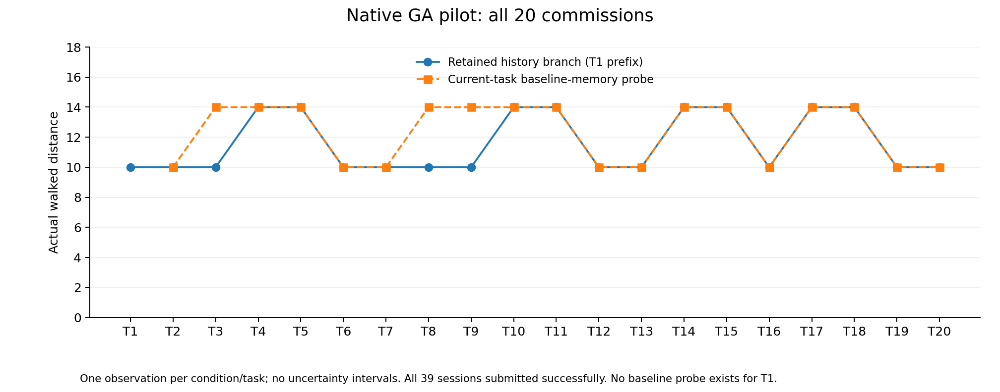
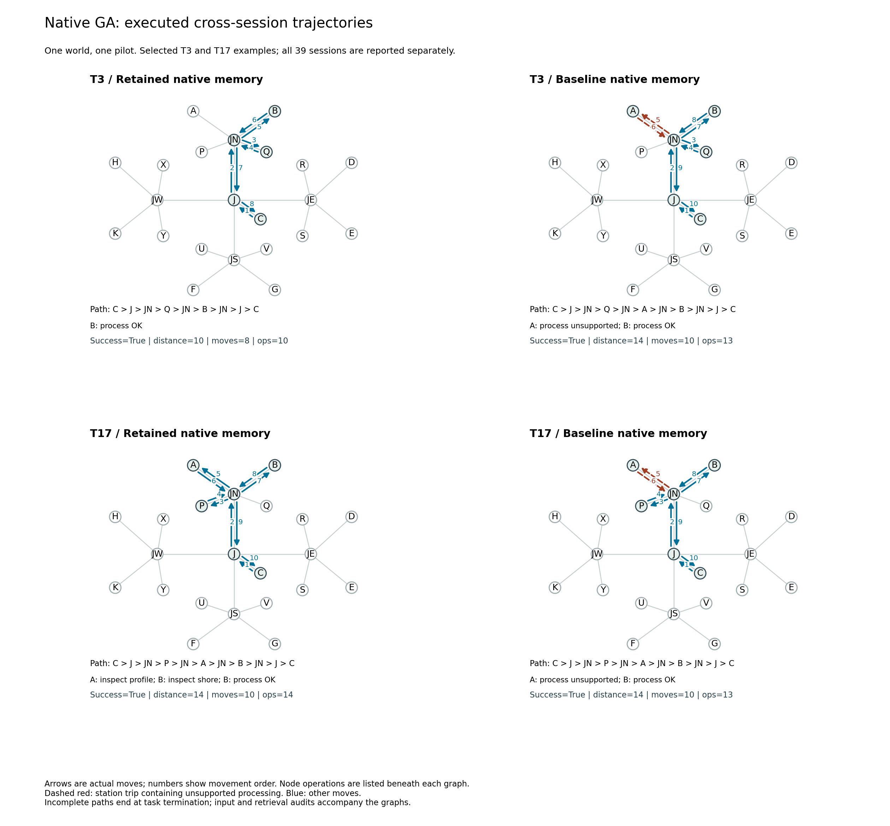
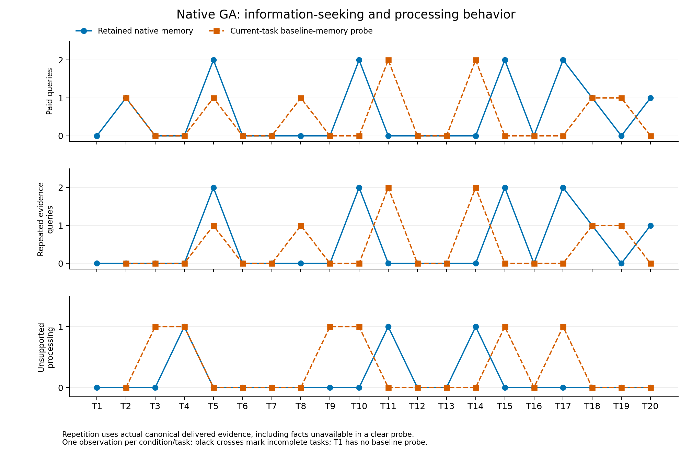

# 岚汀丘地 Easy20：完整原生 GA 试跑

日期：2026-10-26（纽约时间）。地图 `lanting-easy20-v1`；运行源码 `655339f`；原生 GenericAgent；网关模型别名 `gpt-5.6-luna`。

**20 项主线委托与 19 个当前任务清除记忆探针全部成功，共 39 个有效 session、877 次模型调用。** Agent 在 6 项主线委托后自主新增或修改经验文件，但这些文件没有在后续主线首次进站前被读取。最后一次整理还覆盖了一份已有经验，删除了原有 AB 事实。本轮获得了保存、决策与维护之间脱节的实际材料，没有形成可靠的记忆收益证据。

## 完整执行结果

主线共走 232 路程。比较同一组 T2–T20 时，主线走 222，clear 走 234；差异全部来自 T3、T8、T9。其余 16 对距离相同。这些是实际结果，不能直接归因为记忆效果。

| T2–T20 配对范围 | 保留记忆主线 | 当前任务 clear |
| --- | ---: | ---: |
| 成功提交 | 19/19 | 19/19 |
| 路程 | 222 | 234 |
| 通勤边 | 168 | 174 |
| 游戏操作 | 220 | 227 |
| 收费查询 `inspect` | 11 | 9 |
| 不支持的处理 `process` | 3 | 6 |
| 模型调用，含整理 | 406 | 450 |

T1 是共同真实前缀，没有 clear。全部 39 个 session 合计 **457 次游戏操作、350 条通勤边、107 次节点操作**；模型调用分为 677 次主阶段、200 次整理阶段。实际最多 14 次游戏操作、37 次主阶段模型调用，均在约定预算内。

|委托|主线距离|clear 距离|主线查询／错误处理|clear 查询／错误处理|开始前已获相关反馈|主线模型调用／clear|
|---|---:|---:|---|---|---|---|
|T1|10|—|0 / 0|—|否|21|
|T2|10|10|1 / 0|1 / 0|否|20 / 21|
|T3|10|14|0 / 0|0 / 1|是|16 / 30|
|T4|14|14|0 / 1|0 / 1|否|20 / 22|
|T5|14|14|2 / 0|1 / 0|是|23 / 22|
|T6|10|10|0 / 0|0 / 0|否|19 / 18|
|T7|10|10|0 / 0|0 / 0|是|17 / 17|
|T8|10|14|0 / 0|1 / 0|是|21 / 22|
|T9|10|14|0 / 0|0 / 1|是|25 / 34|
|T10|14|14|2 / 0|0 / 1|是|24 / 25|
|T11|14|14|0 / 1|2 / 0|是|26 / 22|
|T12|10|10|0 / 0|0 / 0|是|19 / 21|
|T13|10|10|0 / 0|0 / 0|是|14 / 17|
|T14|14|14|0 / 1|2 / 0|是|21 / 43|
|T15|14|14|2 / 0|0 / 1|是|27 / 27|
|T16|10|10|0 / 0|0 / 0|是|18 / 17|
|T17|14|14|2 / 0|0 / 1|是|32 / 27|
|T18|14|14|1 / 0|1 / 0|是|27 / 21|
|T19|10|10|0 / 0|1 / 0|是|19 / 23|
|T20|10|10|1 / 0|0 / 0|是|18 / 21|

“已有相关反馈”按实际主线交互史计算，不代表事实已经被 Agent 保存或带入当前模型输入。clear 的反馈和新记忆不推进主线。模型调用列包含独立计数的整理阶段，因此 T14 clear 的总数 43 没有违反 40 次主阶段上限。

## 自主保存了什么，后续有没有调用

主线 6 次实际内容变化均由 Agent 原生工具完成，没有评测端代写：

| 委托结束后 | 文件 | 核对到的游戏事实与变化 |
| --- | --- | --- |
| T1 | `lanting_survey_sop.md` | A 支持剖面；按公开互补规则推知 B 支持岸线 |
| T5 | `survey_game_t5.md` | D 支持方位、E 支持高程 |
| T7 | `lanting_easy20_game_sop.md` | F 支持岩性 |
| T10 | 同上 | 保留 F，追加 G 支持植被 |
| T16 | 同上 | 保留 F/G，追加 H 支持水系 |
| T20 | `lanting_survey_sop.md` | 覆盖旧内容，改为 H 支持水系、K 支持等高线及本次流程 |

16 项主线委托开始前已有本项相关历史反馈，其中 12 项的输入记忆文件中已有相关事实，包含可由同组互补规则确定的信息。T5、T7、T14、T16 是“之前获得过反馈，但相关事实尚未实际保存”的四个机会，不能与已保存后未调用混为一谈。

全部 19 对任务的首轮实际转发输入、工具定义和 reasoning 配置完全相同。`global_mem_insight.txt` 未更新，自动带入首轮输入的索引没有新增游戏经验。全部 20 个主线 session 在首次移动进入处理站之前，工具只有 `game_action` 和普通回复，没有文件读取或脚本检索；不包括提交后的复盘读写。T16 等委托提交后确实读取过已有文件，这不能反向解释已经完成的路线选择。clear T17 曾搜索空的基础 `global_mem.txt`，没有获得游戏经验。

因此，T3、T8、T9 的短路线没有观察到跨 session 经验进入决策的通路。相同模型输入仍可产生不同选择；三次配对优势不构成记忆复用证明。

**T15 提供了更直接的行为案例。** T10 已明确保存“F=岩性、G=植被”。T15 需要植被资料，记忆文件仍在输入目录；Agent 却走 `C→J→JS→U→JS→F→JS→G→JS→J→C`，先查询 F 再查询 G，路程 14。首次进站前没有读取经验。这里可以确认事实保存和行动利用之间存在缺口，不能把问题归成“从未获得该经验”。

**T20 出现了实际内容丢失。** 原生 `file_write(mode=overwrite)` 将 T1 创建的 `lanting_survey_sop.md` 整体替换为 HK 经验，AB 事实消失；其余两份游戏经验文件中也没有 AB 事实。这发生在最后一项任务之后，尚无后续任务检验其行为后果，不能声称已经测得遗忘导致的额外路程。

## 图与节点事件提供了什么信息

T3 与 T17 的选择在首个有效 session 完成前固定：分别对应任务目录首次回到 AB，以及 AB 最长间隔后的委托。全部其他会话进入总图和逐例数据，没有按结果另选成功案例。

T17 两组都成功、走相同地点序列、距离 14。主线在 A 查询剖面、到 B 查询岸线后处理成功，共 14 次操作；clear 在 A 处理失败、到 B 处理成功，共 13 次操作。T10 也有相同结构：两组路径、成功和距离相同，节点操作分别是“两次查询”和“一次不支持的处理”。地点集合或普通拓扑会丢掉这些差异，有序通勤多重图附着节点操作与反馈后才保留它们。

本轮可自动计算额外站点往返、首次处理是否匹配、查询与处理的顺序、重复获取已交付证据，以及它们与自主记忆保存／读取的关系。它们暂作行为描述，不合并成固定记忆分数。`process` 本身也会公开能力且失败保留资料，所以更少 `inspect` 不自动意味着更好记忆；查询差异也可能来自当前任务的操作策略。

T2–T20 主线的 11 次查询中，10 次未缩小评测侧根据实际历史维护的相容世界集合；clear 的 9 次中有 8 次如此。这个历史包含 clear 无法自动读取的旧反馈，不能把 clear 的数值解释成“忘记了自己的记忆”。

## 运行协议与复核

每项为新原生进程、空对话和空工作状态；仅原生 memory 可跨 session 持久化。公共地理图相同，不自动携带旧能力反馈。主线使用此前自主保存的记忆，clear 从对应主线任务前检查点恢复完整原生基础记忆。模型与提示相同，每项 18 次游戏操作、40 次实际主阶段模型调用、6 次整理调用，协议为 `environment-gated-1`。普通循环返回在环境未结束时继续同一会话，预算不重置。

39 个 session 中，20 个整理阶段实际返回 `MAX_TURNS_EXCEEDED`，另外 19 个返回 `CURRENT_TASK_DONE`；主线分别为 10 和 10。仅调用数等于 6 不据此判超限，使用原生返回值核对。本轮结果包含这项维护预算约束，不能推广为 GA 在更充分整理预算下的能力结论。试跑中未修改 Agent 的记忆机制、索引、提示或游戏规则。

世界由宿主独立私有抽样，本轮为 `omega_0010`；种子 20261026 不决定能力分配。模型别名不独立证明底层模型身份。单个世界、单条历史与十九个不同任务探针不构成十九次独立重复实验，不报告统计显著效果。

启动阶段有两次 T1 首个模型请求的 `gateway_transport_error`，均为零游戏动作，原始尝试独立归档并从任务前状态恢复。另有三次生成诊断请求，不驱动 Agent、不进入记忆链，与 877 次有效调用分开保存。加入的宿主异常记录包装器不改请求；故障未再出现，未确认具体根因。没有依据游戏结果重跑有效 session。

最终私有证据包 **3,115 个文件逐一通过 SHA-256 校验**；全部会话 **5,174 条累计事件记录逐条重放一致**，其中本 session 事件共 496 条，包含 39 次开始与 457 次实际操作。记忆输入／输出链、20 项主线历史、39 个独立空会话、隔离、请求／响应计数和预算均核对通过。10 个冻结运行文件匹配 `655339f` 的显式 Windows CRLF 归档，原生 GA 压缩包 SHA-256 也与本地原件一致。

三组 PNG／SVG／PDF 已生成并目视检查。大地图采用描述性分析，未调用昂贵精确策略搜索；未计算的最优参考字段为 `null`。此前本地完整 134 项检查通过 128 项，6 项因可选 MCP SDK 或软链接权限跳过；分析新增的 4 项针对性测试通过，实际 39 session 重放提供本轮验证。

- [全部 39 项公开测量](data/easy20-native-pilot-20261026.json)
- [完整通勤图与节点事件投影](data/easy20-native-traces-20261026.json)
- [人工核对的游戏记忆事实与文件指纹](data/easy20-native-memory-audit-20261026.json)
- [逐会话重放与源码审计](data/easy20-native-replay-audit-20261026.json)
- [执行与分析约定](../docs/EASY20_NATIVE_PROTOCOL.md)

公开数据不含模型请求正文、推理内容、原生基础 SOP 正文或凭据。完整私有记录保存在 Squishy 的 `C:/Codes/memorybenchmark-private/easy20-native-pilot-20261026/`；本地副本为 `.runs/easy20-native-pilot-final-20261026/`，分析输出为 `.runs/easy20-native-analysis-final-20261026/`。本地最终压缩包 SHA-256：`a11a43e2a2137da5902dc0f04356c1d3d3258916a43153e6b14984ff1bbb7f4d`。

这轮已经提供长期任务流中的未调用、重复获证和覆盖经验案例。下一步应先核对原生记忆发现与维护协议，明确整理预算如何作为统一实验条件，再组织多世界、多次重复；本轮不通过代写索引或临时增加预算把结果改成正向收益。
