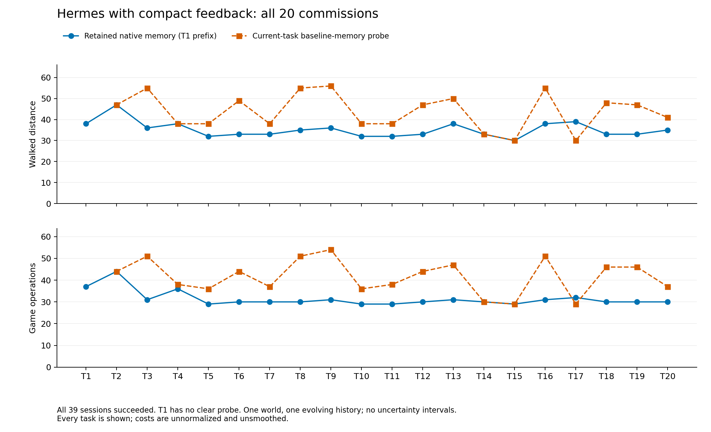
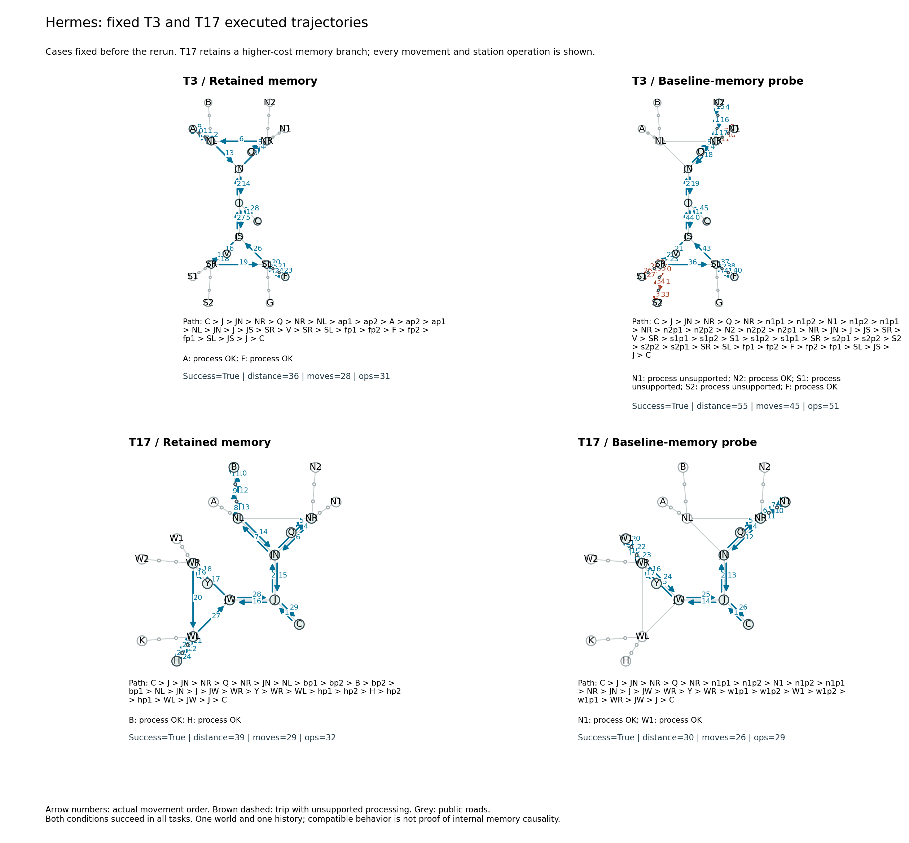

# Hermes 精简反馈：完整二十项联程试跑

这轮 20 项主线、19 个当前任务清除记忆探针全部成功。两组在 T2–T20 的成功率都是 19/19，执行轨迹仍显示清楚的差异：保留组少用 196 次操作、少走 167 距离，首次选站匹配为 36/38，对照为 18/38。成功率相同没有掩盖探索、选站和路线成本。

|T2–T20，同一任务前检查点分叉|保留自主记忆|恢复原生基础库|
|---|---:|---:|
|成功委托|19/19|19/19|
|游戏操作|592|788|
|道路距离|666|833|
|移动次数|532|689|
|首次分支匹配|36/38|18/38|
|首次选择此前反馈已排除的站|0|15|
|不匹配处理|3|22|
|inspect 查询|0|20|
|模型调用|779|961|

操作减少 **24.9%**，路程减少 **20.0%**，均以清除组总数为分母。十九项全部双方成功，没有从失败任务的低路程获得节省。按任务逐项看，操作为 15 项更少、3 项相同、1 项更多；距离为 14 项更少、4 项相同、1 项更多。



[完整会话表](../docs/assets/hermes-linked-compact/all-sessions.csv)、[配对汇总](../docs/assets/hermes-linked-compact/comparison.json)和[全部游戏轨迹投影](../docs/assets/hermes-linked-compact/trace-projection.json.gz)覆盖每项结果；图没有平滑、插值或补造 T1 对照。

## 自主记忆与选站

二十项主线中，17 项修改 MEMORY.md；T11、T12、T18 保留已有正文。十九项后续主线的首个真实模型请求均含此前自主保存的 MEMORY.md 正文。T7 另生成了 `survey-game-routing` skill。检查点记忆同时包含实测站点能力和已执行路线，没有人工向它写入经验。

根据此前主线实际交付的反馈，后续共有 34 段行程可确定至少一个匹配站。保留组在这些机会中首次分支匹配 34/34，清除组为 16/34；这里“机会”属于评测侧的实际反馈史，不自动等同于 Agent 已保存或已收到每条具体事实。全文送达与行为兼容分别核对，没有把它们当作内部使用某条记忆的直接证据。

在全部后续 38 段中，保留组只有 16 次首次选择地理最近站，清除组为 36 次。保留组没有首次走向历史已排除的站，清除组有 15 次；清除组不接收这些历史事实，这个数量用于描述行为差异，不将未知探索处罚为记忆错误。原始反馈、节点操作和完整有序通勤边都保留在[公开投影](../docs/assets/hermes-linked-compact/trace-projection.json.gz)与[逐段证据统计](../docs/assets/hermes-linked-compact/signal.json.gz)中。

## 固定案例：记忆也会保留较贵的路线

沿用运行前固定的 T3、T17，没有按本轮收益挑图。

|任务|保留：操作／距离|清除：操作／距离|
|---|---:|---:|
|T3|31／36|51／55|
|T17|32／39|29／30|

T3 的保留组到 A、F 处理，清除组依次尝试 N1、N2、S1、S2、F，失败处理和额外支路清楚进入图。T17 则相反：保留组使用匹配的 B、H，清除组在 N1、W1 成功，后者距离更短。记住一个可用站，并不保证找到了当前任务最便宜的组合。



箭头编号是实际移动顺序，棕色虚线表示包含不匹配处理的支路；原始节点操作列在每张图下方。可缩放版本：[SVG](../docs/assets/hermes-linked-compact/fixed-t3-t17-traces.svg)、[PDF](../docs/assets/hermes-linked-compact/fixed-t3-t17-traces.pdf)。

## 与上一轮及实验版本的关系

|同一世界的两次独立自主运行|完整回显，上一轮|精简回显，本轮|
|---|---:|---:|
|主线成功|18/20|20/20|
|清除探针成功|17/19|19/19|
|双方成功的任务对数|16|19|
|该子集操作降幅|5.3%|24.9%|
|该子集路程降幅|4.3%|20.0%|
|后续首次匹配，保留／清除|21/38、18/38|36/38、18/38|

上轮见[完整报告](HERMES_LINKED_EASY20_PILOT.md)。两个成本百分比的成功子集不同，不能将其差值直接当作协议效应。这次重新从原生基础库开始，Agent 生成了新的历史与记忆；仅有一个世界、每种协议一条历史，没有多种子重复。协议还新增完整地图查询说明。结果支持继续验证精简反馈，但尚不能把全部变化归因于减少回显，也不能拆分站点事实、路线记忆与自写 skill 的独立贡献。

运行冻结 `b1f3247`、原生 Hermes `e5ea5fd`、模型网关别名 `gpt-5.6-luna`、世界 `omega_3051`、worker seed `20261027`。公开地图、任务、72 次游戏操作预算、100／6 次模型调用、3,600 秒 session 时限及 64,000 上下文配置与上轮相同。新提示协议为 `station-native-memory-3`，回显为 `station-compact-feedback-1`；开局与 read 仍完整提供公开地图，不附送历史站点能力。

## 完成、恢复与核验

39 个有效 session 共 1,784 次模型调用、1,417 次游戏操作、1,253 次移动。四次基础设施中断另存：两次通信错误、两次 HTTP 502，共 88 次模型调用尝试；只在清理与网关检查通过后，从原任务前检查点恢复，没有重跑有效游戏失败。所有实际尝试均保留，39 个有效 session 的行为统计不混入这些中断尝试。

39 项原始行为、14,210 条累计事件记录严格重放通过；记忆链、全新会话与隔离、原生归档以及 39 份适配器交付日志指纹均核验。所有 12 份冻结源文件另在本地按实际 CRLF 字节与 Git 提交逐一核对，没有修改冻结运行或其原始哈希。

普通动作响应共 1,449,562 字符，平均约 1,023 字符；这里统计适配器的动作 JSON，不含初始地图、read、原生包装和模型 token。完整模型日志、记忆快照及完整证据归档在服务器私有保存，公开导出不含模型推理或凭据。[运行溯源](../docs/assets/hermes-linked-compact/run-provenance.json)、[行为与记忆链核验](../docs/assets/hermes-linked-compact/verification.json)、[Git 字节核验](../docs/assets/hermes-linked-compact/git-source-verification.json)、[实际交付核验](../docs/assets/hermes-linked-compact/feedback-delivery-audit.json)提供相应记录。

游戏执行于 2026-10-29 03:05 UTC 完成，自动核验及归档于 03:24 UTC 完成。以下命令从公开数据重新生成统计和图，不调用模型：

```powershell
python -m scripts.report_compact_hermes_pilot --source docs/assets/hermes-linked-compact --output .runs/hermes-compact-report
```
