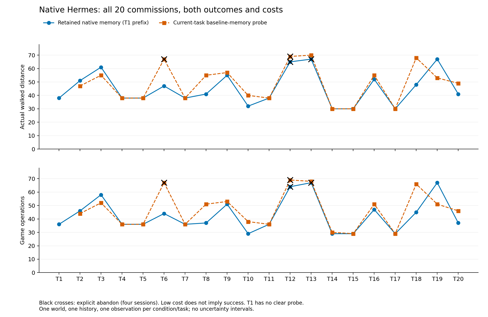
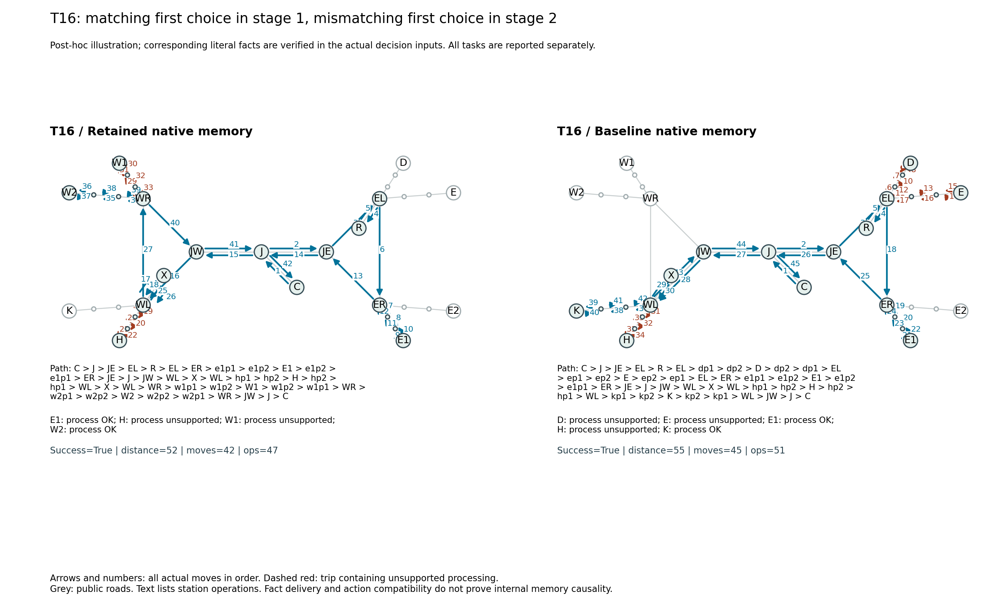

# Hermes 联程 Easy20：真实试跑与记忆行为核查

2026-10-28，`lanting-easy20-linked-v3`，单个预先抽取的世界 `omega_3051`。本轮只运行 Hermes。

**已经跑完。记忆带来的成本差仍然较小，但轨迹和实际输入已经能区分一部分“经验已送达、行动符合／不符合经验”的情况。** 在双方都成功的 16 对任务中，保留记忆用了 648 次操作、清除记忆用了 684 次，减少 **5.3%**；路程为 690／721，减少 **4.3%**。相同 19 项任务的成功数均为 **17/19**。

这两个成本比例只描述双方都成功的子集，不能当成完整任务流的总体记忆效应。全部任务、失败和反向差异均列在下面。

## 执行与对照

- 主线 T1–T20 共 20 个 session，成功 18 项。T1 同样计分，从原生基础记忆开始，不是训练任务。
- 在主线 T2–T20 的每个实际历史检查点，再运行一次恢复原生基础记忆的当前任务探针，共 19 个。T1 没有先前任务经验，因此不重复建立清除对照。
- 每项使用全新进程和空任务上下文；两段行程在同一个原生 loop 中完成，任务结束后在同一 session 自主整理经验。只有主线的实际经历与输出记忆推进后续；清除探针不形成另一条独立演化的二十项任务流。
- 地图、任务、公开地理、游戏反馈、记忆提示和预算沿用冻结协议，评测器没有代写能力经验。只有 Agent 自己生成的原生记忆在主线跨 session 传递。
- 共 39 个有效 session、2,561 次模型调用、1,747 次实际游戏操作、1,542 条实际移动边。本轮没有基础设施中断或重试。

主代码版本为 `c4f9dc3e3a3f9f60cbd1feddb770ed2e25a49320`；原生 Hermes 为 `e5ea5fd9ccdf2913c0b21b24eb3d22b321d2e2a6`，保持上游循环与原生记忆工具。模型使用网关别名 `gpt-5.6-luna`，该别名不能独立证明后端模型身份。每项预算为 72 次游戏操作、100 次主阶段调用、最多 6 次同会话收尾调用，原生进程总时限 3,600 秒；上下文配置为 64,000 tokens。实际进程耗时范围为 312.7–867.7 秒。

此前旧目录中的两次基础设施失败尝试继续保留：一次网关中断，一次 T1 提交后整理超过启动器遗漏更新的 900 秒时限。它们没有完整有效 session，不计入本轮成绩。修复后沿用原先抽取的世界，从全新基础记忆重跑；没有根据收益另选世界。

## 全部结果

|比较项|保留记忆，T2–T20|清除记忆，T2–T20|
|---|---:|---:|
|成功任务|17/19|17/19|
|首次进入的站点支路实际匹配|21/38|18/38|
|首次支路选择地理最近站|34/38|38/38|
|不匹配处理次数|39|46|
|双方均成功的 16 项：操作合计|648|684|
|双方均成功的 16 项：路程合计|690|721|

“首次支路选择”在采集之后、离开分岔进入站点支路时确定；其匹配性由实际能力反馈核对。它不等于首次查询或首次处理。地理最近按公开道路从采集点到候选站的距离计算。

16 对成功任务中，保留记忆操作更少 7 项、相同 6 项、更多 3 项；路程更少 6 项、相同 7 项、更多 3 项。T18 的操作差为 21，T19 则反向增加 16，均保留在总表中。



以下每格为“结果；路程／操作”。失败项的低成本不作为效率收益。

|任务|主线保留记忆|当前任务清除记忆|
|---|---|---|
|T1|成功；38／36|无对照|
|T2|成功；51／46|成功；47／44|
|T3|成功；61／58|成功；55／52|
|T4|成功；38／36|成功；38／36|
|T5|成功；38／36|成功；38／36|
|T6|成功；47／44|放弃；67／67|
|T7|成功；38／36|成功；38／36|
|T8|成功；41／37|成功；55／51|
|T9|成功；55／51|成功；57／53|
|T10|成功；32／29|成功；40／38|
|T11|成功；38／36|成功；38／36|
|T12|放弃；65／64|放弃；69／69|
|T13|放弃；67／67|成功；70／68|
|T14|成功；30／29|成功；30／30|
|T15|成功；30／29|成功；30／29|
|T16|成功；52／47|成功；55／51|
|T17|成功；30／29|成功；30／29|
|T18|成功；48／45|成功；68／66|
|T19|成功；67／67|成功；53／51|
|T20|成功；41／37|成功；49／46|

四个失败均为 Agent 通过游戏工具明确执行 `abandon`，当时只完成第一段。T6 clear、T12 retain、T12 clear、T13 retain 的主阶段调用分别为 87、87、93、91，均未耗尽 100 次上限，也没有触发进程时限。放弃是有效游戏失败，未重跑。

## 写入、送达与行动

主线 20 项都更新了原生 `memories/MEMORY.md`；后续 19 项的首轮实际请求均包含上一项传下来的自写记忆正文。文件变化、记忆链与输入正文匹配已核对。主线没有新增游戏专用 skill 正文；锁文件和使用统计不算经验内容。清除探针恢复基础库，因此没有继承主线自写正文。

**正文被写入并送达，仍不足以证明它保存了所有相关事实，也不足以证明决策使用了这些事实。** 因此另核对了三个事后选取的局部案例：实际历史确有支持、自写片段确在输入记忆中、片段确在首轮及作出分岔选择的那一次请求中。只公开短游戏事实，不公开模型推理或完整原生转录。

|案例|已送达的自写经验|实际首次分岔选择|可观察结论|
|---|---|---|---|
|T16 第一段，需要高程|“E1为高程匹配站”|绕过最近的 D，选择 E1；清除探针先选 D|选择符合相关经验，且不同于最近站策略|
|T16 第二段，需要等高线|“H 站处理水系资料”“W2 处理等高线成功”|先走 H 支路并处理失败，随后还试 W1，最后 W2 成功|相关经验已在决策输入中，首次行动仍不符合经验|
|T20 第二段，需要等高线|“水系在 W1 处理”“W2 处理等高线成功”|先选 W1，处理失败后再去 W2|偏离最近站也不必然是正确复用经验|

这些是行为和输入证据，不能据此断言内部必然调用了某条记忆，或有意识忽略了它。三个案例事后用于解释，不用于估计整体经验应用率。逐片段支持事件、输入哈希与分岔编号见[核查数据](../docs/assets/hermes-linked-easy20/reviewed-cases.json)。



图中每支箭头是一条实际移动边，数字为移动顺序；红色虚线表示包含不匹配处理的实际站点支路，蓝线表示其他移动。节点处理、支路往返和段切换均保留。红线不是自动判定的“记忆错误”，未知时试探也可能有信息价值。

另保留原先选定的 [T3／T17 配对图](../docs/assets/hermes-linked-easy20/fixed-t3-t17-traces.png)：T3 保留记忆反而多走一趟 S1，T17 两组路线完全相同。不能只选择收益最大的轨迹展示。

主线历史反馈已能排除的站点仍被首次选中 14 次；这是评测器历史的判断，不等于这 14 次的具体事实都被 Agent 保存并收到。尤其不能把清除组缺失的历史信息当成其记忆错误。

## 这轮对实验设计的意义

本轮已能从图中定位多走了哪条支路、何时首次选错站、同一任务两段是否表现不同，再通过节点反馈和实际记忆输入判断原因所在。只看成功率，会把 T16 两组都记成成功，遗漏第一段减少试探、第二段仍重复试探的差异。

目前仍以最近站试探为主，保留记忆在 38 次选择中只有 4 次偏离最近站，整体收益有限。接下来应先核查能力事实的提取、更新和行动对应：例如把已确认能力保存成可直接查用的组织形式，是否是 Agent 自己能做到的；是否在换资料类型时错误沿用熟悉站点。应保留当前环境作对照，再决定是否需要增加新机制。单纯加长支路只能放大成本，不能解决经验没有可靠对应到行动的问题。

本轮仅有一个世界、一条主线历史，没有跨世界重复；既不作 Agent 排名，也不估计统计显著性。双方成功子集也不是总体效应。此前 **19.9%** 是相同脚本反馈策略在全部世界上的环境校验结果，不是最优上界，不是 Hermes 的预期成绩；不能与此轮单世界 5.3% 直接当成同一估计量比较。

## 数据与复现

服务器与本地完整证据包共 19,346 个文件，逐文件指纹核对通过。39 个 session 的 18,264 条累计事件记录全部严格重放，包含重复出现的历史；去掉这些重复历史后，本轮有 1,786 条当前 session 事件，其中 1,747 次游戏动作和 39 次任务开始。记忆链、空上下文、隔离、冻结源码与原生归档均通过核对。

- [配对统计与全部任务数值](../docs/assets/hermes-linked-easy20/comparison.json)
- [全部测量记录，gzip JSON](../docs/assets/hermes-linked-easy20/measurements.json.gz)
- [游戏事件与有序通勤图，gzip JSON](../docs/assets/hermes-linked-easy20/trace-projection.json.gz)
- [本地严格重放与记忆链审计](../docs/assets/hermes-linked-easy20/replay-audit.json)
- [冻结版本、预算及证据归档指纹](../docs/assets/hermes-linked-easy20/run-provenance.json)
- [公开文件指纹](../docs/assets/hermes-linked-easy20/artifact-manifest.json)

公开投影只含游戏事件、数值、核查过的短游戏经验与来源哈希；完整请求、响应和记忆目录保存在私有证据包。PNG 均附有 SVG／PDF 版本，源数据无平滑或补点。

仅从公开数据重画全部任务成本和 T16 图，不调用模型：

```powershell
python -m scripts.report_linked_hermes_pilot --output docs/assets/hermes-linked-easy20
```

持有私有证据包时，先重做完整测量，再核对经验与实际输入；输出使用新目录：

```powershell
python -m scripts.analyze_station_native --run PRIVATE_EVIDENCE --output .runs/linked-native-analysis --skip-exact-references --trace-tasks T3 T17
python -m scripts.report_linked_hermes_pilot --run PRIVATE_EVIDENCE --analysis .runs/linked-native-analysis --output .runs/linked-native-report
```

本轮没有计算昂贵的未知世界最优策略参考；报告中的成本差来自真实配对运行。制图方法为有序多重图投影加节点事件，不能用两张图的外形相似度替代记忆证据。
