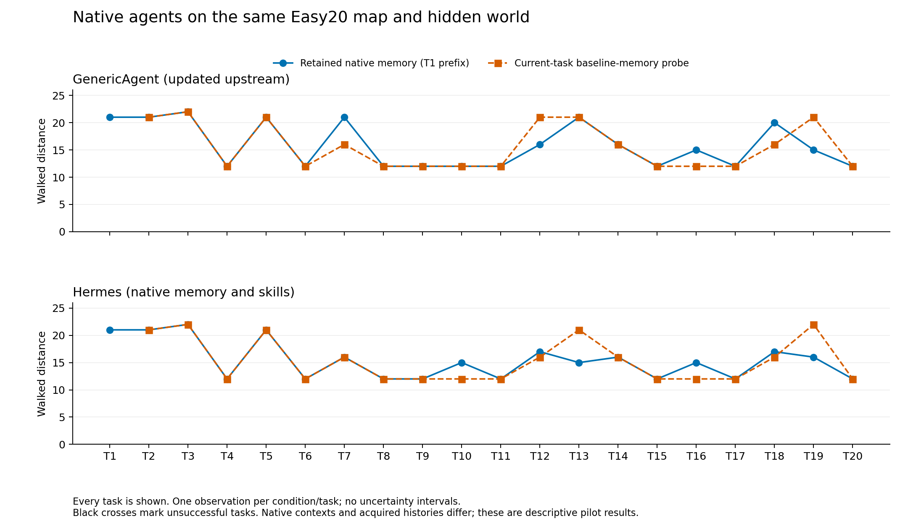
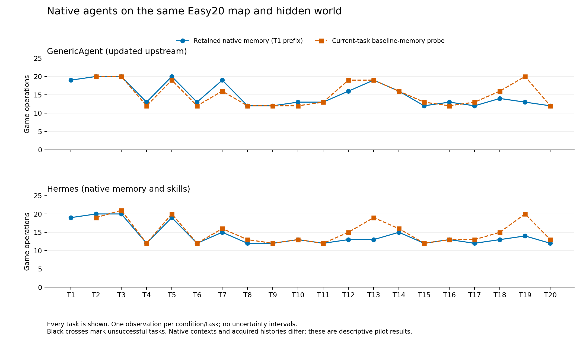
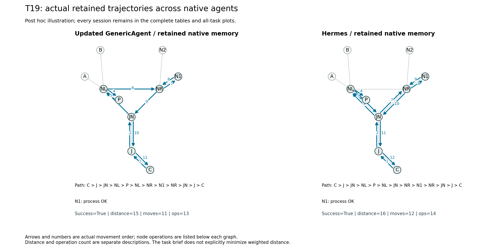

# 新版 GenericAgent 与 Hermes：Easy20 原生跨 session 复跑

运行日期：2026-10-27（纽约时间）。两套 Agent 各完成 20 项主线和 19 项当前任务清除记忆对照，**有效会话共 78 项，全部成功**。新版 GA 使用 852 次模型调用，Hermes 使用 983 次。两者都自行生成了经验，并在后续任务中读取；本轮记录同时出现了符合旧经验的选站、已送达经验未体现在选站中的行为，以及匹配站选择相同而路线不同的情况。

GA 固定至上游 [e4d956f](https://github.com/lsdefine/GenericAgent/commit/e4d956f0207a2d268704634473196353946481bc)，Hermes 固定至上游 [e5ea5fd](https://github.com/NousResearch/hermes-agent/commit/e5ea5fd9ccdf2913c0b21b24eb3d22b321d2e2a6)。均通过同一游戏 MCP 接入，保留原生循环与记忆工具。网关请求使用同一个模型别名 `gpt-5.6-luna`；别名不独立证明底层模型身份。

## 完整结果

地图为 `lanting-easy20-choice-v2`：38 个地点、45 条带权道路，四组各四座候选站，每种资料有两座匹配站。两套运行使用同一个私有 fixture `omega_5511`、同一任务顺序。每项从 C 出发，到目标自动采集，在匹配站处理后回 C 提交；上限为 24 次游戏操作、40 次主阶段模型调用和同会话内最多 6 次额外整理调用。

|Agent／分支|成功|路程|通勤|操作|inspect|不支持的 process|模型调用|
|---|---:|---:|---:|---:|---:|---:|---:|
|新版 GA 主线 T1–T20|20/20|317|239|301|16|6|424|
|新版 GA clear T2–T20|19/19|295|227|288|16|7|428|
|Hermes 主线 T1–T20|20/20|308|232|283|3|8|472|
|Hermes clear T2–T20|19/19|291|225|286|15|8|511|

T1 没有 clear；下面只比较双方均成功的相同 19 项任务，避免把 20 项主线总量直接和 19 项对照总量比较。

|Agent／T2–T20 分支|路程|通勤|操作|模型调用|
|---|---:|---:|---:|---:|
|新版 GA 保留|296|224|282|397|
|新版 GA clear|295|227|288|428|
|Hermes 保留|287|217|264|442|
|Hermes clear|291|225|286|511|

新版 GA 的保留分支比 clear 少 6 次操作、3 次通勤，带权路程多 1；Hermes 少 22 次操作、8 次通勤、4 个距离单位。这是本轮观察到的配对差异，未据一个世界、每条件一次的运行作统计排名。





所有有效场次均成功。各图不作平滑、插值或显著性估计；T1 的 clear 留空。通勤按实际移动次数计，操作还包括查询、处理和提交；路程按道路权重累计，单位为游戏距离。

|委托|GA 保留 距离／操作|GA clear 距离／操作|Hermes 保留 距离／操作|Hermes clear 距离／操作|GA 首站|Hermes 首站|
|---|---:|---:|---:|---:|---|---|
|T1|21／19|—|21／19|—|A|A|
|T2|21／20|21／20|21／20|21／19|D|D|
|T3|22／20|22／20|22／20|22／21|N2|N1|
|T4|12／13|12／12|12／12|12／12|F|F|
|T5|21／20|21／19|21／19|21／20|E1|E1|
|T6|12／13|12／12|12／12|12／12|H|H|
|T7|21／19|16／16|16／15|16／16|S1|S1|
|T8|12／12|12／12|12／12|12／13|N1|N1|
|T9|12／12|12／12|12／12|12／12|E1|E1|
|T10|12／13|12／12|15／13|12／13|S1|F|
|T11|12／13|12／13|12／12|12／12|D|D|
|T12|16／16|21／19|17／13|16／15|F|S2|
|T13|21／19|21／19|15／13|21／19|D|E1|
|T14|16／16|16／16|16／15|16／16|W1|W1|
|T15|12／12|12／13|12／12|12／12|F|F|
|T16|15／13|12／12|15／13|12／13|H|H|
|T17|12／12|12／13|12／12|12／13|A|A|
|T18|20／14|16／16|17／13|16／15|W2|W2|
|T19|15／13|21／20|16／14|22／20|N1|N1|
|T20|12／12|12／12|12／12|12／13|H|H|

“首站”指采集后、处理成功前首次进入本任务候选站群；两套主线分别有 16/20、14/20 次选择地理最近站，距离按公开道路最短带权路程计算。全部逐步事件及节点操作均进入公开数据，不从 Agent 的路线自述生成图。

## 自主经验与后续行为

新版 GA 在 20 项主线后均更新 `survey_game_sop.md`，其中 T3、T7、T16、T17、T18、T19、T20 共 7 项在首次进站前调用文件工具读取该 SOP。原生全局索引在 T2–T20 的首轮输入中出现，但索引出现本身不代表游戏能力事实被读到。

Hermes 有 15 项主线修改 `MEMORY.md` 正文，在 T4 自行创建 `cartography-game` skill，11 项主线修改该 skill。T2–T20 的首轮输入实际包含上一主线产生的 MEMORY.md 文本；T5–T20 共 16 项在首次进站前请求读取自写 skill，**脚本逐项验证了对应版本的完整 Markdown 正文已进入模型输入**。锁文件、使用统计与 ledger 不作为新增经验数。这些计数描述维护和送达，尚未合成为记忆能力分数。

- **经验已送达，选站仍不匹配：** GA T3 的第 2 次模型请求含已有“N1/N2 为剖面”的事实，却先去 N2、再去 N1 处理岸线资料；Hermes T3 首轮已收到“N1 支持 profile”，仍先去 N1。两边最后都成功，但相关准确旧事实没有反映为这次首站的正确筛选。[GA 核查](../docs/assets/native-agents-easy20/ga/t3-memory-case.json)、[Hermes 核查](../docs/assets/native-agents-easy20/hermes/t3-memory-case.json)分别保留经验文件、实际请求与事件指纹。
- **符合旧经验的重复任务选择：** GA T19 进站前读到自存 N1 剖面经验，直接去 N1，路程 15；clear 为 21。Hermes T13 首轮收到旧 E1 方位事实、读取自写 skill 后首站选择 E1，路程 15；clear 为 21。[GA T19](../docs/assets/native-agents-easy20/ga/t19-memory-case.json)、[Hermes T13](../docs/assets/native-agents-easy20/hermes/t13-memory-case.json)均核对了事实由先前真实反馈支持，且在当前选站前进入模型输入。这些是与经验复用相容的行为证据，单次配对不证明内部因果机制。
- **同一匹配站，路线仍有差别：** T19 两套主线都已收到 N1 剖面事实并选择 N1。GA 走 NL→NR，Hermes 走 NL→JN→NR，分别为 11／12 次通勤、距离 15／16。选对站与后续路线选择能够分开观察。



原先固定展示的 T3、T17 配对图也完整保留：[GA](../docs/assets/native-agents-easy20/ga/native-trace-comparison.png)、[Hermes](../docs/assets/native-agents-easy20/hermes/native-trace-comparison.png)。T17 的空间路径与路程相同，保留分支在 A 直接 process，clear 多一次 inspect，操作分别为 12 和 13；节点事件保留了纯通勤拓扑看不到的差别。T19 为事后说明例，全部 78 项仍进入表和总图。

环境统计自动由权威事件与图计算。能力事实片段是人工选择的说明例，事实支持、原始文件匹配和进站前送达由脚本验证；skill 全文送达检查覆盖全部 20 项主线，包括最初尚无该 skill 的 4 项。读取、事实送达、行为相容和总体收益分别记录。

## 解释边界与运行协议

**当前任务说明要求在操作预算内成功提交，没有明确要求最小化带权路程。** 因此路程差是行为成本描述，不能单独当作违反目标、规划失败或记忆失败。将这些代价转成正式质量分前，需要先明确目标函数；本轮并列保留路程、通勤、操作和匹配选择。

未知站点上的不支持 process 与 inspect 都耗一次操作、都公开能力，失败 process 保留原资料，因此“不支持次数”也不能直接作为惩罚分。信息重复按评测侧实际交付历史计算；clear 看不到被清除的旧经验，不据此指责其遗忘。没有运行 1,296 世界的精确未知世界策略搜索，也没有将全知最短路径差距直接解释为记忆缺陷。

每项均启动新原生进程，初始对话、后端历史和工作状态为空，只传递 Agent 自主维护的原生记忆。clear 恢复各自的原始库，保留出厂通用技能；不是一个独立演化的完整 NOMEM 流。Hermes 的会话数据库、日志和缓存每项重建，持久化 memories、skills 和技能回滚数据；后台整理的实际模型调用计入公共预算。两套 Agent 的实际获证历史、原生提示、工具和上下文管理不同。

原生运行环境为 GA Python 3.12.3、Hermes Python 3.14.10；宿主 Python 3.13.7、MCP SDK 1.30.0。GA 的历史裁剪参数为 `context_win=50000`，Hermes 为 `model_context_length=64000`，单位和机制不同，不声称相同 token 上下文预算。worker RNG seed 为 20261027，未固定提供方模型采样。游戏内核、任务配置、共用记忆提示与工具定义的字节／常量一致性已[核对](../docs/assets/native-agents-easy20/shared-protocol-check.json)；各自完整运行器快照另存，不以最终工程提交替代实际运行源码。

## 中断、验证与数据

安装联调阶段首个 Hermes 启动曾中断：21 个请求记录、20 个响应、0 个有效会话，未进入本轮记忆链。有效 Hermes 流的 T14 clear 另有一次 I/O 中断：游戏已经提交、26 个响应齐全，但通信结束、未形成合格收尾快照；原样归档，从相同检查点和原始库重试，同一冻结版本成功完成，路程仍为 16。既有主线和经验未重跑或改写。原始报错被管道错误覆盖，该次底层原因未能从日志确定；之后的宿主修复保留排队中的 worker 错误、IO 错误码与退出状态，并以两个真实子进程回归用例验证。

有效表共 1,835 次请求／响应；上述另存的基础设施尝试共 47 个请求、46 个响应，不混入有效成绩。没有重跑有效的游戏失败。恢复探针、两套真实原生循环的脚本模型契约检查均不调用真实模型；契约检查覆盖新会话、经验／技能保留与清除、技能回滚，以及预算耗尽后的同会话整理。

GA 的 4,035 个归档成员与 Hermes 的 16,430 个成员逐项校验通过。分别累计重放 7,142／6,764 条事件记录，含重复出现的历史前缀；当前会话事件为 628／608 条。合计 1,158 次实际操作、923 条实际通勤。所有记忆输入／输出链、新会话隔离、实际 worker support 文件与上游归档指纹验证通过。18 个被拒绝的游戏请求单列，不伪造为已执行动作或移动边。

服务器 153 项测试和 [Windows／Linux、Python 3.10／3.12 CI](https://github.com/dd3xp/memorybenchmark/actions/runs/40575233463)通过。成图已检查并导出 PNG／SVG／PDF，数据和源码指纹如下：

- [GA 配置](../docs/assets/native-agents-easy20/ga/run-configuration.json)、[逐项量](../docs/assets/native-agents-easy20/ga/measurements.json)、[执行图与节点事件](../docs/assets/native-agents-easy20/ga/trace-projection.json)、[选择审计](../docs/assets/native-agents-easy20/ga/station-decisions.json)、[重放核查](../docs/assets/native-agents-easy20/ga/replay-audit.json)。
- [Hermes 配置](../docs/assets/native-agents-easy20/hermes/run-configuration.json)、[逐项量](../docs/assets/native-agents-easy20/hermes/measurements.json)、[执行图与节点事件](../docs/assets/native-agents-easy20/hermes/trace-projection.json)、[选择审计](../docs/assets/native-agents-easy20/hermes/station-decisions.json)、[skill 全文送达](../docs/assets/native-agents-easy20/hermes/skill-delivery-audit.json)、[重放核查](../docs/assets/native-agents-easy20/hermes/replay-audit.json)。
- [配对汇总](../docs/assets/native-agents-easy20/combined/comparison.json)、[图片来源](../docs/assets/native-agents-easy20/combined/figure-manifest.json)、[GA 冻结运行器](../docs/assets/native-agents-easy20/ga-frozen-runtime-source.zip)、[Hermes 冻结运行器](../docs/assets/native-agents-easy20/hermes-frozen-runtime-source.zip)。两份运行器各 59 个源码／配置文件，内含清单，均不含第三方源码或原始模型会话。
- [全部公开文件指纹与私有归档指纹](../docs/assets/native-agents-easy20/artifact-manifest.json)、[部署与中断记录](../docs/assets/native-agents-easy20/deployment-validation.json)、[运行环境版本](../docs/assets/native-agents-easy20/runtime-versions.json)。

完整原始证据留在 Squishy 私有目录 `C:/Codes/memorybenchmark-private/native-agents-20261027/`，公开包保留审计过的游戏数据、经验片段与指纹。模型调用的原生记忆写入内容由 Agent 决定；没有人工向 Agent 补入站点能力事实。

从公开数据复画对照图，无需调用模型：

```powershell
python -m scripts.compare_station_native --analysis docs/assets/native-agents-easy20/ga --analysis docs/assets/native-agents-easy20/hermes --output .runs/native-agents-comparison --trace-task T19
```

真实原生接入及独立 runtime 的安装命令见[接入说明](../docs/AGENT_INTEGRATION.md)；图生成需要 Matplotlib，版本记录在图片清单中。
