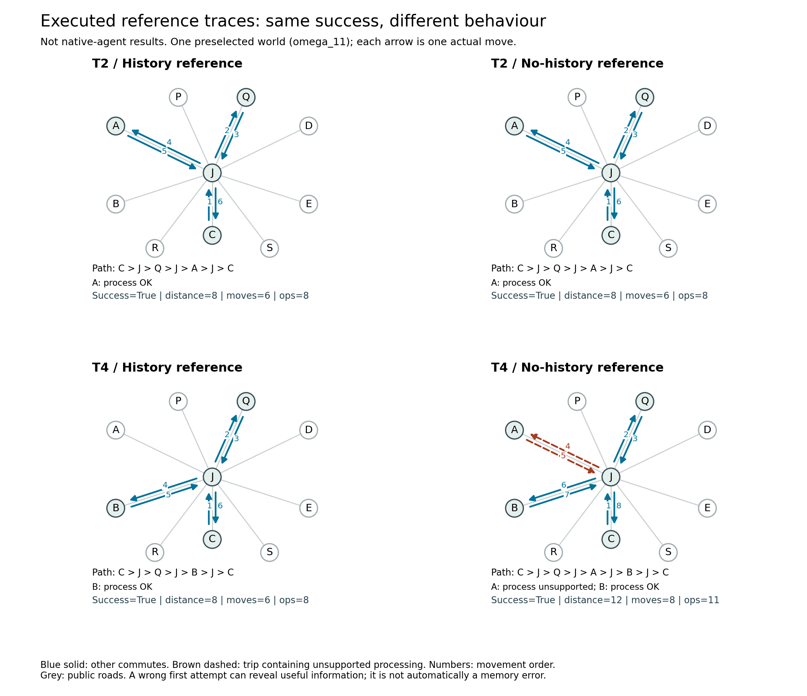
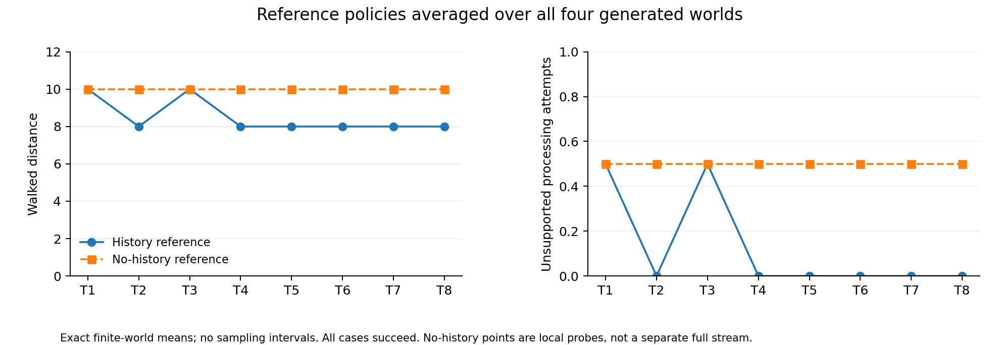
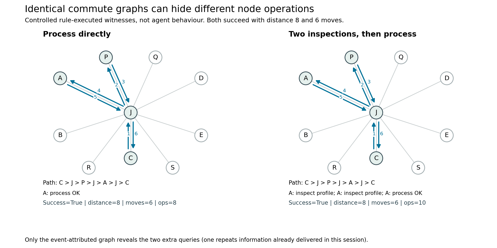

# 新版原型的执行图与可测行为

日期：2026-10-25。设计：`station-capability-v2`。以下区分规则引擎执行、脚本模型的原生接入检查与真实模型行为，三者不混报。

后续更新：网关已修复，已补完 15 个真实 GA session，见 [真实轨迹报告](STATION_NATIVE_GA_PILOT.md)。本报告保留参考策略分析和初次零动作故障尝试的记录。

## 实际执行范围

重新执行了 **288 条匹配参考轨迹**，逐条从原始反馈生成图并计算描述量；另执行两条受控表示样例，检验相同通勤图能否掩盖不同节点操作。反馈均来自游戏引擎，没有手绘或虚构轨迹。参考策略不是 Agent 自主记忆成绩。

新版动作已接入 MCP 与原生 GA。Squishy 上真实 GA＋WSL 沙箱＋MCP 的三 session 离线检查通过，覆盖查询／处理、提交、保留／恢复基础记忆与临时文件清除；模型响应为脚本，因此不计自主行为。

随后用现有 `gpt-5.6-luna` 网关别名启动八项委托及七个当前任务清除分支。第一项第一次模型请求返回 502，**游戏动作数 0，有效真实模型轨迹 0**。网关明确报告上游 `127.0.0.1:6268` 拒绝连接；已有 `BoostProxyBoot` 任务启动失败，其脚本指向的旧 Boost 可执行文件已不存在。未更换模型、凭据、代理配置或线上游戏。失败请求和隔离证据另存，不计任务或记忆失败。

## 成图揭示的差异



固定展示默认顺序 T2、T4 与世界 `omega_11`，同时提供全部四世界汇总，保留没有差异的情况。

T4 两个分支都成功。有历史信息时走 `C→J→Q→J→B→J→C`，距离 8、6 次移动、8 次操作；无历史时先在 A 处理失败，再转 B，距离 12、8 次移动、11 次操作。多出的 `J→A→J` 权重为 4，附有一次“不支持”的处理反馈。成功率看不到这部分行为。

但 T2 两分支都直接去 A，距离均为 8。未知时第一次也可能选对，故**正确路径和短距离不是记忆使用证明**。带历史信息的参考策略也不是会自行保存／读取记忆的 Agent。



| 默认任务 | 历史信息参考平均距离 | 当前无历史参考平均距离 | 历史／无历史平均不支持处理次数 |
| --- | ---: | ---: | ---: |
| T1 | 10 | 10 | 0.5／0.5 |
| T2 | 8 | 10 | 0／0.5 |
| T3 | 10 | 10 | 0.5／0.5 |
| T4–T8，各项 | 8 | 10 | 0／0.5 |

这是四个枚举世界的等权精确均值，不是模型重复实验，无统计置信区间。全部分支成功。无历史点是同一实际历史下的当前任务探测，不是一条独立演化的无记忆任务流。T3 仍需发现第二组能力，说明已有信息不一定与当前目标相关。

## 为什么必须保留节点事件



两条受控轨迹的路径均为 `C→J→P→J→A→J→C`，都成功，距离 8、6 次移动。第一条到 A 直接处理；第二条查询两次再处理，多两次操作，第二次查询重复本 session 已得到的信息。只保存地点和移动边，两图完全相同；附着节点操作、反馈与顺序后才能区分。此样例用于验证表示，不是实际 Agent 过度查询的证据。

因此使用**有序带属性的通勤多重图**：每次通勤单独保留，操作、反馈和操作前后状态关联地点。合并为简单地点图会丢信息。同一地点可反复出现，对应不同资料状态；既有 v1 样例也验证了相同距离、移动数、操作数下的不同获证顺序。

## 当前可以自动计算的候选量

暂不冻结最终维度和综合分数。

| 描述量 | 图与事件中的依据 | 解释边界 |
| --- | --- | --- |
| 完成代价、成功后的额外距离 | 边权和；成功时减完整真值下的物理最短可行距离 | 未知时探索有必要；不能把所有超额距离归为遗忘，失败时此项留空 |
| 不支持处理的站点往返 | 进入站再回到同一相邻点的通勤段，关联处理反馈、求段权重 | 首次试错可能获得信息；未返回便结束的尝试不计完整往返 |
| 首次处理是否正确 | 首个处理节点的实际反馈 | 可能碰巧正确，不能单次判复用 |
| 重复查询 | `inspect` 前后相容世界是否缩小；分别按本 session 与实际全历史算 | 描述再次查证，不证明保存／检索失败；清除组未必有此前信息 |
| 与已有证据矛盾的处理 | 操作前交付反馈已排除该站支持当前资料，仍尝试处理 | 能定位再犯的位置和顺序，不能确定 Agent 内部记忆状态 |
| 获证与当前任务的相关性 | 历史相容世界是否一致确定本次支持站 | 区分未遇到相关信息与已有相关证据，不等于 Agent 已存入记忆 |
| 探索的信息产出 | 节点反馈前后相容集合变化及相关通勤成本 | 信息量不等于未来价值，探索环不能统一判坏 |
| 获证后的行动与状态顺序 | 时序、`raw/processed`、查询和处理反馈 | 支持行为诊断，不能单独识别内部推理／检索 |

令实际已交付历史为 (H)，相容世界集合为 (K(H))。在这个有限、等权、确定性候选族中，信息缩减量为

\[
I(o\mid H)=\log_2|K(H)|-\log_2|K(H,o)|.
\]

这是评测端的证据描述，不是 Agent 的记忆分数。重复查询只针对 `inspect`；必要的 `process` 即使再次返回已知能力，也不当作无效查询。

成功轨迹的额外距离为

\[
R(G,q)=\sum_{e\in E(G)}w(e)-d^*_{\theta}(q).
\]

完整真值下的 (d^*_{\theta}) 是物理参考，不是未知信息下要求 Agent 达到的标准。当前四世界此值均为 8；无历史最优策略期望距离为 10。失败不能因早停距离小而获高分。

要估计自存记忆的行为作用，仍需同一实际历史下的原生 Agent 保留／清除对照，并核对实际保存和读取。单个配对差值混有模型随机性，需要多世界、多实际历史和重复运行，不能用参考差值代替。

## 对当前环境的判断

图能承载成功率看不到的行为信息；部分来自带权路径，部分来自图上的状态与反馈事件。查询次数等是事件分析量，并不全是纯拓扑图论量。

但当前地图是一棵星形树，每个支路必须经过 J 往返。采集、处理、回营本来就需要回头，不能直接惩罚环或重复访问。中心性、聚类、密度和无标签图编辑距离很难提供超出支路数量／代价的解释。当前是机制校验图，尚不能证明复杂拓扑分析本身有必要。

下一步先取得真实 Agent 轨迹，确认上述差异是否自然出现。后续扩展地图时，应让经验影响有实际区别的路线、准备地点和前置操作，再检验图分析增加了什么解释能力，而不是单纯增加节点或套用图指标。

## 代码、复现与原始记录

[描述量实现](../memorybenchmark/prototypes/station_analysis.py)、[成图脚本](../scripts/analyze_station_graphs.py)、[原生试跑入口](../memorybenchmark/prototypes/station_pilot.py)、[离线原生检查](../scripts/check_station_native.py)。描述量和表示测试见 [test_station_analysis.py](../tests/test_station_analysis.py)，新动作与检查点恢复测试见 [test_station_native.py](../tests/test_station_native.py)。

```powershell
python -m scripts.check_experience_stream --output .runs/reference-fresh
python -m scripts.analyze_station_graphs --reference-run .runs/reference-fresh --output .runs/analysis-fresh
python -m scripts.check_station_native path/to/GenericAgent_src.tar.xz --output .runs/contract-fresh --distro Ubuntu
# 宿主提供 MEMORYBENCH_GATEWAY_KEY；需要正常工作的网关和上游代理。
python -m memorybenchmark.prototypes.station_pilot path/to/GenericAgent_src.tar.xz --output .runs/pilot-fresh --base-url https://your-gateway --distro Ubuntu
```

输出目录须新建；入口从仓库源码运行，需要项目 MCP 依赖、原生 GA 归档与 WSL 运行环境，未注册成线上场景。仅 Agent 自存 memory 跨新进程／上下文传递；工具通路不提供世界真值或未来任务。基础设施错误不推进主线；实现哈希冻结，恢复需沿用原实现。

本机完整回归共 122 项，121 项通过、1 项因 Windows 软链接权限跳过；另完成上述真实原生三 session 离线检查。全量描述量与图的距离、边数逐例核对；PNG 已人工查看，SVG／PDF 同源导出。这些验收不替代真实模型评测。

本次私有记录：`.runs/experience-stream-v2-analysis-20261025/` 保存 288 条原始参考轨迹；`.runs/station-graph-analysis-20261025-final/` 保存逐例描述量、三组 PNG／SVG／PDF、两条表示样例及来源清单；`.runs/station-native-pilot-20261025-blocked/` 保存失败模型请求与隔离证据。不公开模型请求正文、原生源码、记忆快照或凭据。
