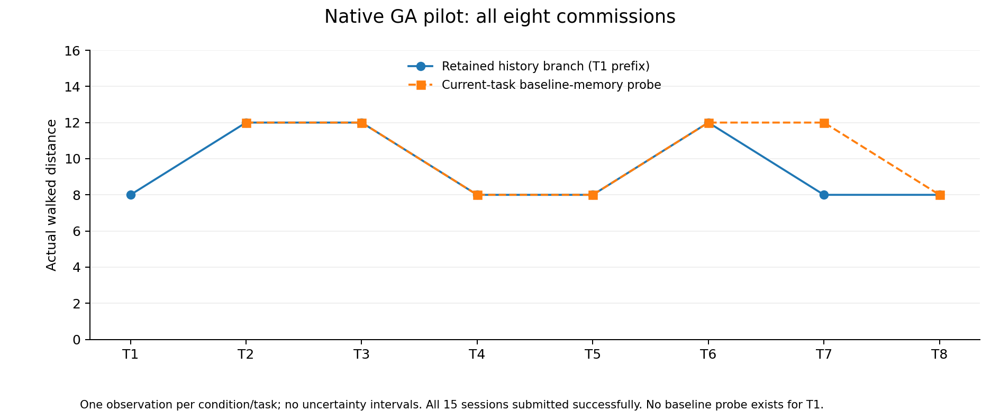
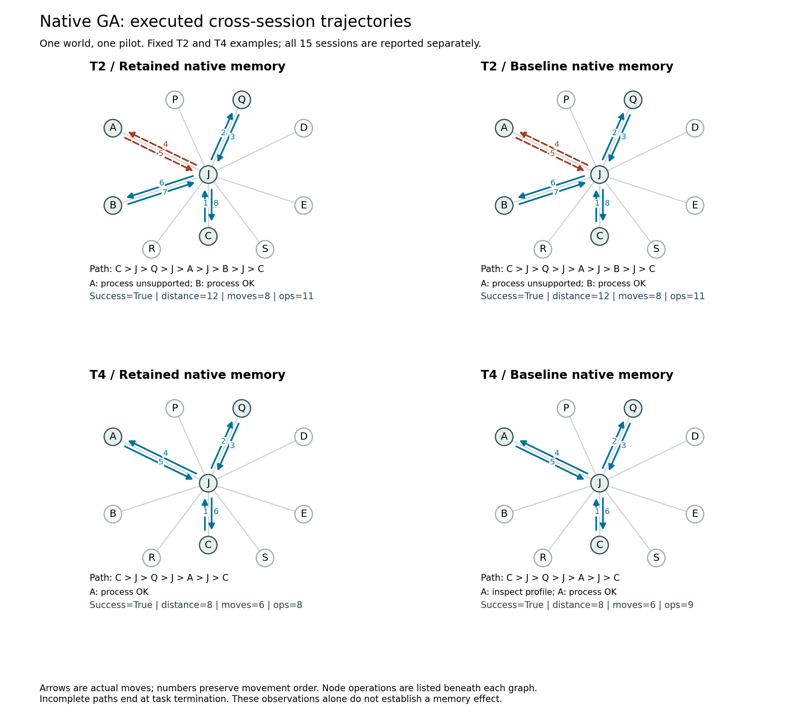

# 修复退出协议后的原生 GA 八委托重跑

日期：2026-10-25（工作区日期；Squishy 已为 10 月 26 日）。设计 `station-capability-v2`，原生 GenericAgent，模型别名 `gpt-5.6-luna`。这是实际模型执行，非脚本策略。沿用上一轮的私有世界夹具 `omega_01`；世界配置不进入 Agent 沙箱或提示。

## 修复及完成情况

**八项主线全部成功，七项当前任务清空记忆对照也全部成功。** 共 15 个有效新 session、283 次模型调用、146 次游戏操作、104 条实际通勤边、加权距离 148。11 个 session 触发续跑，共 37 次；没有 `agent_stopped`、游戏预算耗尽或模型预算耗尽的失败。

[旧试跑](STATION_NATIVE_GA_PILOT.md) 把 GA 原生循环返回直接当作任务终止，造成 12 个未完成任务提前结算。此次修复恢复环境对任务结束的控制：

- 原生循环返回后只读当前公开状态；环境未结束且预算未耗尽时，保留同一个 Agent、handler、模型客户端和历史继续执行。
- 续跑反馈只包含公开状态和“任务尚未结束”的协议说明，不指定下一步、正确站点或历史事实。只读不会生成游戏动作或通勤边。
- 全部实际模型请求共享原先的 40 次主阶段预算；原生工具内部请求也计入，不因续跑重置。任务结束后保留原来的 6 次整理预算。
- 环境提交成功、显式放弃、游戏预算耗尽或模型预算耗尽可以结束任务。宿主拒绝把新版 worker 的普通提前返回结算为 Agent 失败。

任务、工具定义、记忆提示和底层 GA 源码不因本次结果调整。每项新委托仍启动全新原生进程与空对话／工作状态，只有原生 memory 跨 session 保留；同一委托内的续跑保留当前上下文。

实现提交：`bd162ac`。回归测试 126 项，其中 6 项因本机可选依赖／权限跳过；服务器另通过真实原生 GA＋WSL 沙箱＋MCP 的合成协议检查，覆盖中途普通回复、实际提交、保留／恢复基础记忆、临时文件隔离，以及反复普通回复耗尽同一预算。这些合成检查不计入真实 Agent 成绩。

## 逐委托结果

| 委托 | 主线成功 | 主线距离 | clear 成功 | clear 距离 | 主线续跑次数 | clear 续跑次数 |
| --- | --- | ---: | --- | ---: | ---: | ---: |
| T1 | 是 | 8 | 不设 | — | 0 | — |
| T2 | 是 | 12 | 是 | 12 | 4 | 0 |
| T3 | 是 | 12 | 是 | 12 | 7 | 3 |
| T4 | 是 | 8 | 是 | 8 | 4 | 0 |
| T5 | 是 | 8 | 是 | 8 | 0 | 1 |
| T6 | 是 | 12 | 是 | 12 | 2 | 4 |
| T7 | 是 | 8 | 是 | 12 | 1 | 9 |
| T8 | 是 | 8 | 是 | 8 | 1 | 1 |

主线使用实际 prefix／retain 历史。每个 clear 从同一主线检查点恢复完整的原生基础记忆；它获得的信息和写入内容不推进主线。clear 不是独立演化的完整无记忆任务流。

这轮成功率完全相同，轨迹仍显示错误站点往返和查询差异。T7 的主线直接选中 B，clear 先到 A，查询后发现不匹配，再转到 B；多出的往返距离为 4。单世界单次执行的差异不作为稳定记忆收益估计。

## 自生成记忆与行为

8 个有效 session 有实际记忆内容变化。T1 自主保存 A 的能力；T2 补充经验；T4 更新原生 `global_mem_insight.txt`，加入“survey_game: T4验证A支持profile”。该文件是 GA 原生自动加载的记忆入口，不由评测器代写。

因此，显式 `file_read` 只是检索证据的一部分。必须同时核对保存文件、原生自动加载后的真实模型请求，以及选站／查询／处理的实际顺序。输入里出现正确事实表示已向本次 Agent 提供该事实；不能仅凭出现事实或路线较短就断言模型内部使用了它。

实际请求审计确认：T2–T4 保留／清空首轮转发输入相同，T5–T8 开始不同。T7 保留分支的首轮输入含有上述自生成事实，clear 不含；公开规则规定 A/B 各支持 profile/shore 中一种，因此该事实足以确定应到 B。与两分支的实际选站差异结合，这是一次有可追溯输入依据的记忆利用候选证据。全部 15 个 session 首次入站前都没有显式 `file_read`，不妨碍原生自动加载提供经验。

另一个不同案例是 T6：T5 已经把“D 支持 elevation”保存进原生经验文件，但 T6 首轮输入没有该事实，首次入站前也未显式读取文件。它仍先去 D 查询，再去 E 查询并处理，走了距离 12，两次查询都未增加实际历史信息。这里没有发生处理失败；代价来自重复获证和站点往返。图能记录这些行为，记忆文件和输入审计能进一步区分“未保存”与“已有文件但未提供给当前决策”。

T3 主线完成任务但没有记忆内容变化，也说明成功、获证、保存与复用必须分别检查。历史上观察过，不等于当前已成功复用。

## 基础设施中断与复核

本轮有两次独立中断：T4 clear 已提交成功，任务后整理请求返回 HTTP 502；T5 clear 已处理资料并返回营地，但尚未提交，下一次模型请求返回 HTTP 503。两次原尝试均保留为基础设施中断，不记为 Agent 失败，也不将其部分记忆推进主线。两次合计 19 次调用尝试；恢复只重试相应分支，未重跑已有有效结果，未对游戏失败重抽样。含中断共 302 次真实模型调用尝试。

对 15 个有效 session 包含历史的累计日志共 **763 个事件逐一重放**，实际反馈与最终事件表一致；运行冻结的 10 个实现及设计文件哈希与本地对应文件一致，保留／清空的输入记忆来源和全部输出快照一致。成图脚本另核对成功状态、距离、原生初始空上下文、隔离检查、实际调用计数及结束协议；两张图已目视检查。原始输入／输出记忆、模型请求／响应、续跑审计、游戏事件和图完整私有保留；公开数据不含模型请求正文或凭据。

- 服务器：`C:/Codes/memorybenchmark-private/station-pilot-gated-20261025/.runs/native-ga-gated/`。
- 本地私有完整记录：`.runs/station-native-pilot-gated-final-20261025/`。
- 本地分析与图来源：`.runs/station-native-gated-analysis-final-20261025/`。
- [逐例公开描述量](data/station-native-gated-pilot-20261025.json)。
