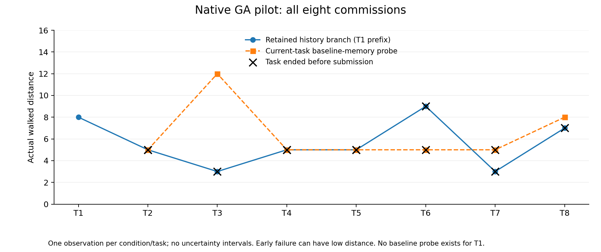
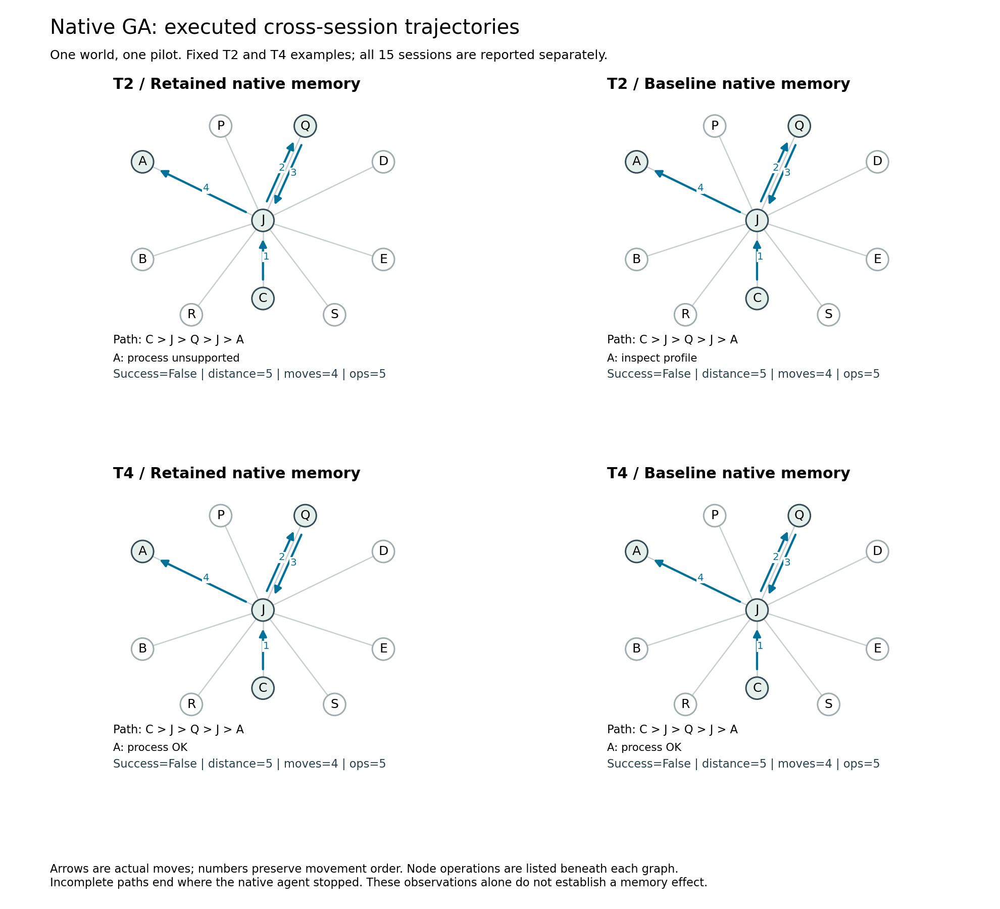

# 新版测绘机制的首轮真实 GA 轨迹

日期：2026-10-25。设计 `station-capability-v2`；原生 GenericAgent；网关模型别名 `gpt-5.6-luna`。本轮是真实 HTTPS 模型调用，不是参考规划器或脚本模型。模型别名不独立证明底层模型身份。

后续核查确认：本轮接入将原生循环的普通返回直接作为任务终止，遗漏了 AAAI runner 在环境未结束时的续跑。因此，下文 12 个 `agent_stopped` 只能作为旧接入的运行记录，不能据此评价 Agent 持续执行或记忆能力。原始记录保留，[修复后独立重跑](STATION_NATIVE_GA_CONTINUATION_RERUN.md) 已完成全部 15 个有效 session；不覆盖或混算两轮结果。

## 执行与结果

修复 [网关出站代理](SQUISHY_GATEWAY_DIRECT_EGRESS.md) 后，新建独立私有运行目录，完成八项委托的实际主线与 T2–T8 的当前任务清除分支，共 **15 个新 session、185 次模型调用、89 次游戏操作、69 条通勤边**。无基础设施错误、无失败重抽样。此前第一次请求便被 502 中断的零动作尝试不计入本轮。

每项都是新原生进程与空对话／工作状态；原生 memory 是唯一可跨 session 持久写入的空间。设施分配由宿主私有抽样，在整轮保持，和传给原生 worker 的随机种子独立。两组提示与预算相同：40 次主循环模型调用、6 次任务后整理调用；游戏预算 16 次操作。

主线是 prefix／retain 的实际执行。clear 从同一个实际历史检查点恢复原生基础记忆，其发现和新写内容不推进主线；不能把 clear 列当作独立演化的完整无记忆任务流。

| 委托 | 主线成功 | 主线距离 | 当前 clear 成功 | clear 距离 | 开始前实际历史已有本次相关信息 |
| --- | --- | ---: | --- | ---: | --- |
| T1 | 是 | 8 | 不设 | — | 否 |
| T2 | 否 | 5 | 否 | 5 | 是 |
| T3 | 否 | 3 | 是 | 12 | 否 |
| T4 | 否 | 5 | 否 | 5 | 是 |
| T5 | 否 | 5 | 否 | 5 | 否 |
| T6 | 否 | 9 | 否 | 5 | 是 |
| T7 | 否 | 3 | 否 | 5 | 是 |
| T8 | 否 | 7 | 是 | 8 | 是 |

3 个 session 成功提交；12 个失败均为原生循环自行停止，由宿主记录 `agent_stopped`，没有伪造 abandon 动作。其中 6 个已采集但未处理，另外 6 个已处理但未回营提交。没有因游戏预算耗尽而失败。

早停导致的短距离不能算高效。例如 T8 主线走 7、clear 走 8，前者停在岔口，后者回营提交；不能据此说主线更好。

## 自存记忆与检索证据

9 个 session 有实际记忆内容变化。T1 的 Agent 自己写出 `survey_game_sop.md`，记录了“A 支持剖面资料，能力跨委托保持不变”。这条事实与实际反馈一致，没有由评测端代写。

T2 需要岸线资料，retain 输入文件系统里确实有该经验文件，但仍走到 A，处理反馈为不支持；随后它用文字说要经 J 改去 B，却结束了原生循环，没有执行后续移动。

核对实际模型请求发现，T2 保留／清除首轮转发内容完全相同，保存的事实与文件名都未进入首轮请求；T2 在处理前也没有调用文件读取或脚本工具检索该经验。图可以定位与已有证据矛盾的处理，结合读写日志后，才有“保存过相关事实，但本次未观察到检索”的行为证据。不能只看到文件就判复用，也不能只看到错误就判存储失败。

全部 7 对任务的首轮实际转发输入均相同；所有 session 在第一次移动进入处理站之前，没有文件读取工具调用。后者的观察窗口到宿主 `task_end` 为止，排除了提前停止后的经验整理阶段；没有进入站点的任务也不会把结束后的读取误算为行动前检索。这些是工具和输入层面的观察，不是对模型内部过程的直接测量。

因此，本轮没有形成可靠的原生记忆收益证据。不能把主线仅 T1 成功与 clear 的两次成功解释为“记忆有害”；存在明显的提前停止与模型行为变异，而且只有一个私有世界、一个实际历史。

## 失败后是否仍可评测

本轮直接验证了按实际反馈维护机会的必要性：

- T3 主线只采集后返回岔口便停止，没有获得 D/E 组反馈，因此 T5 开始前无相关信息。不把 T5 的重新调查标作忘记了 T3 应当学会的内容。
- T3 clear 虽然成功并获得 D/E 信息，它是旁路探测，其信息不进入主线，不能补给 T5。
- T5 主线已在 D 查询并处理资料，随后未回营提交。尽管任务失败，设施反馈已经实际交付，因此 T6 开始前确有相关历史信息。

历史的信息机会来自真实轨迹，不来自任务成功标签或作者预先规定的经验表；任务失败既可能无信息，也可能留下可用于后续的经验。

## 实际图能测什么

T2 两分支同路径、同距离、同操作数、同样失败，但 retain 在 A 处理失败，clear 在 A 查询能力。T4 的路径和距离也相同，处理已经成功，停止时尚未返回营地。地点图形本身不能区分这些状态，必须附着操作、反馈和顺序。

当前实际可自动核对的行为包括：完成阶段与停止位置、首次处理是否匹配、针对已获证事实的查询／处理、获证与行动的顺序，以及成功轨迹的额外通勤。失败的额外距离留空；未完成往返不能假装完整试错环。已有描述量实现见 [参考图测量报告](STATION_GRAPH_MEASUREMENT_PILOT.md)。

后续代码核查将提前停止定位到了接入协议，不能把它归因于 Agent 持续完成任务的能力。自存文件用于行动的证据仍需在修复后重新检查。本轮保留为旧协议记录，不用于校准最终记忆指标；修复试跑使用新的目录和协议标识。

## 复核与原始记录

[成图脚本](../scripts/analyze_station_native.py) 自动核对了 15 个 session 的距离、边数、成功状态、初始空上下文与隔离检查，生成逐例描述量与 PNG／SVG／PDF；图片已目视检查。另外将各例包含实际历史的累计日志共 530 个事件逐一重放，反馈与最终事件表完全一致；运行记录的实现源码哈希与本地源码相符。原始输入／输出记忆清单、每次真实模型请求／响应、游戏事件和图均保留。

- 服务器：`C:/Codes/memorybenchmark-private/station-pilot-restored-20261025/.runs/native-ga-restored/`。
- 本地私有完整记录：`.runs/station-native-pilot-restored-final-20261025/`。
- 本地分析、图与来源清单：`.runs/station-native-analysis-reviewed-20261025/`。

公开仓库只保存测量数据和成图；完整模型输入、原生源码、记忆快照与凭据不公开。对应 [逐例公开描述量](data/station-native-pilot-20261025.json) 没有模型请求正文或认证信息。
